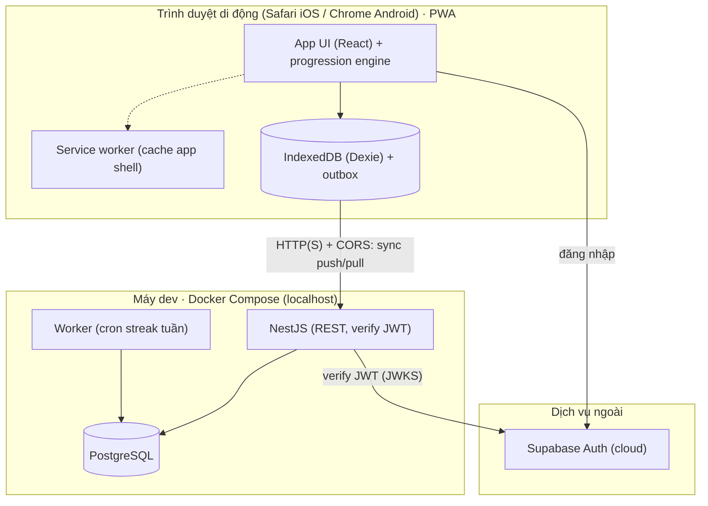
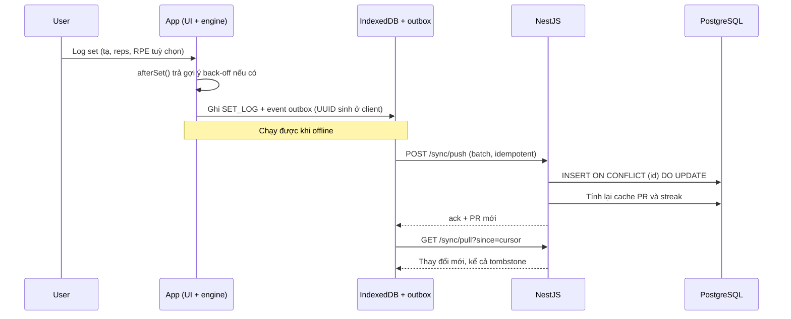
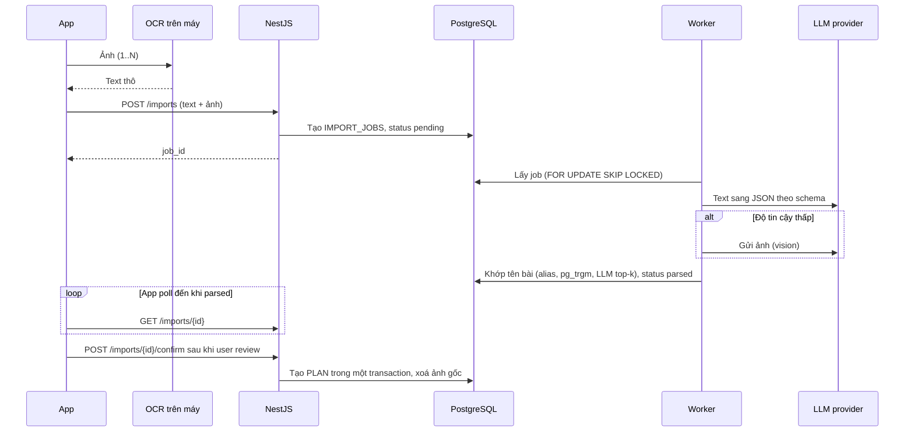

# SDD – Fitness Tracking and Training System

Tham chiếu SRS cùng dự án.

## 1. Giới thiệu

### 1.1 Mục đích

Tài liệu này mô tả thiết kế kỹ thuật (SDD) cho Fitness Tracking and Training System, hiện thực các yêu cầu đã nêu trong SRS. SDD tập trung vào kiến trúc, thiết kế dữ liệu, và các quyết định kỹ thuật — không lặp lại nội dung yêu cầu chức năng (xem SRS cho use case đầy đủ).

### 1.2 Phạm vi

Bao gồm: kiến trúc hệ thống (client, backend, các dịch vụ ngoài), thiết kế dữ liệu (ERD), luồng xử lý chính (ghi set & đồng bộ; import lịch tập — post-MVP), nguyên tắc thiết kế API, bảo mật & triển khai, quyết định kỹ thuật, và khả năng mở rộng.

Không bao gồm: đặc tả API chi tiết từng endpoint (làm riêng theo hướng contract-first, cùng lúc với code), thiết kế UI/wireframe (làm riêng ở công cụ thiết kế), phân công vai trò trong team (không thuộc phạm vi kỹ thuật).

### 1.3 Quy ước đọc tài liệu

Các quyết định kế thừa từ giai đoạn Requirements được đánh số **D\<n>** để tiện tham chiếu chéo với lịch sử thảo luận trước đó; số D không liên tục vì một phần quyết định (D2, D3, D4, D13, D15, D21, D23–25) đã được viết trực tiếp thành yêu cầu trong SRS, không lặp lại ở đây. Quyết định bị thay thế được giữ lại trong bảng mục 10 kèm ghi chú quyết định thay nó (vd D5 → D26).

### 1.4 Phạm vi MVP

MVP (cập nhật 15/10/2026, khớp SRS mục 3.3; nền tảng client đổi sang PWA ngày 16/11/2026 — D26) là bản demo cuối kỳ: web app di động (PWA) chạy trên Safari iOS và Chrome Android, backend chạy localhost. Cách demo cụ thể chưa chốt (SRS 6.1). Các nhóm dưới đây là post-MVP; thiết kế liên quan vẫn giữ trong tài liệu và được đánh dấu *post-MVP* ở tiêu đề hoặc cột trạng thái.

| Nhóm post-MVP | Phần thiết kế liên quan |
| --- | --- |
| Import lịch tập bằng LLM | OCR trên máy (3.5), hàng đợi import (4.2), luồng import (6), object storage, adapter LLM (11.3), D9, D18, bảng `IMPORT_JOBS` |
| Tích hợp Health Connect | Bản bọc native bằng Capacitor (D26), `DeviceProvider` (3.1, 11.2), dữ liệu thiết bị (9.2), bảng `DEVICE_CONNECTIONS`, `DAILY_ACTIVITIES`, tuân thủ Google Play (9.7) |
| Video hướng dẫn kỹ thuật | Cron kiểm tra link video chết (4.1), bảng `EXERCISE_VIDEOS` |
| Beta công khai và triển khai | Deploy frontend và backend lên server, tự host auth (4.4, D7), hosting VN (9.3, D20), backup (9.6), privacy policy (9.7), Web Push |

## 2. Kiến trúc tổng quan



*Sơ đồ trên là kiến trúc MVP. Kiến trúc đích (post-MVP) bổ sung: frontend và backend deploy lên server HTTPS (backend trên VPS — D20); bản bọc native (Capacitor) để truy cập Health Connect và phát hành Google Play; object storage cho ảnh import và job import trong worker phía backend; LLM provider và Web Push phía dịch vụ ngoài.*

**Nguyên tắc kiến trúc:**

- **Local-first cho phiên tập:** web app (IndexedDB) là nguồn dữ liệu tạm thời khi offline, backend là nguồn chuẩn (source of truth) sau khi đồng bộ.
- **Progression engine chạy hoàn toàn trên client:** pure function, không gọi mạng, không phụ thuộc backend — đảm bảo gợi ý hoạt động cả khi offline.
- **Backend là modular monolith:** một NestJS app + một worker, chạy chung một máy (localhost ở MVP, một server khi lên beta) — đơn giản hoá vận hành, không cần điều phối nhiều service.
- **Mỗi dịch vụ ngoài qua một lớp adapter:** LLM provider và thiết bị sức khoẻ (Health Connect/HealthKit) (cả hai là post-MVP) đều được bọc qua adapter riêng, để đổi nhà cung cấp mà không sửa logic nghiệp vụ.

## 3. Kiến trúc web client (PWA)

### 3.1 Nền tảng

PWA (D26, thay D5 ngày 16/11/2026): một codebase TypeScript chạy trên Safari iOS và Chrome Android, cài lên màn hình chính như app. Thư mục `apps/web`, dựng bằng CLI chính thức của từng công cụ:

| Phần | Công nghệ | Ghi chú |
| --- | --- | --- |
| Build + dev server | Vite + React + TypeScript | `npm create vite@latest` (template react-ts) |
| PWA | `vite-plugin-pwa` (Workbox, `generateSW`) | Manifest, service worker cache app shell; `registerType: 'prompt'` để bản cập nhật không tự reload giữa buổi tập; icon sinh bằng `@vite-pwa/assets-generator` |
| Routing | React Router, Data mode (`createBrowserRouter`) | SPA thuần, không SSR |
| Lưu trữ cục bộ | Dexie (IndexedDB) + `dexie-react-hooks` (`useLiveQuery`) | Xem 3.2 |
| Dữ liệu từ server | TanStack Query | Catalog, PR, biểu đồ, lịch sử |
| UI | Tailwind CSS + shadcn/ui (`--base radix`) | Component được copy vào repo; theme mặc định, map design (Stitch) sau |
| Auth | supabase-js | Xem 9.1 |
| Test | Vitest + Testing Library | Cùng Vitest với `packages/engine`, `packages/contract` |

Khác biệt iOS/Android (cài app, rung, xoá bộ nhớ, Web Push — SRS 5.5) xử lý bằng *feature detection* trong cùng codebase, không tách nhánh code. Trên iOS mọi trình duyệt đều dùng WebKit, nên test phải chạy trên Safari/iPhone thật — Chrome DevTools không giả lập được hành vi WebKit.

Lớp truy cập thiết bị sức khoẻ vẫn bọc qua interface `DeviceProvider`. PWA không truy cập được Health Connect/HealthKit, nên implementation (post-MVP) chạy trong bản bọc native bằng Capacitor, dùng lại toàn bộ code web; bản PWA dùng implementation rỗng (không có thiết bị).

### 3.2 Local-first: IndexedDB + outbox

- Toàn bộ dữ liệu phiên tập (`WORKOUT_SESSIONS`, `SESSION_EXERCISES`, `SET_LOGS`) được ghi vào IndexedDB (qua Dexie) ngay khi user thao tác, với UUID sinh ở client (không chờ server cấp id) — cho phép ghi set hoàn toàn offline. UI đọc qua `useLiveQuery` nên tự cập nhật khi dữ liệu đổi.
- Mỗi thay đổi ghi thêm một sự kiện vào bảng outbox (khoá tự tăng = thứ tự đẩy), trong **cùng một transaction Dexie** với bản ghi gốc. Outbox được đẩy lên server theo thứ tự, dùng `POST /sync/push` với upsert idempotent (`INSERT ... ON CONFLICT (id) DO UPDATE`) — gửi lại không tạo trùng.
- **Thời điểm đẩy:** sau mỗi lần ghi, khi có sự kiện `online`, và khi `visibilitychange` chuyển sang hiện. Không dùng Background Sync API (Safari không hỗ trợ); service worker không tham gia đồng bộ.
- Kéo dữ liệu mới từ server bằng `GET /sync/pull?since=<cursor>`, cursor là `updated_at` lớn nhất đã nhận; xoá được biểu diễn bằng tombstone (`deleted_at`) để đồng bộ đúng cả việc xoá.
- Đóng tab hoặc hệ điều hành dừng app giữa buổi tập: phiên đang dở được khôi phục từ IndexedDB khi mở lại (không mất dữ liệu chưa sync).
- Sửa một set đã sync: ghi đè cục bộ rồi đẩy lại; xung đột xử lý last-write-wins (chấp nhận được vì bình thường chỉ một thiết bị ghi cho một user).
- **Chống trình duyệt xoá dữ liệu chưa sync** (SRS 5.3): gọi `navigator.storage.persist()` khi khởi động; đẩy outbox sớm; trên iOS, nếu app đang chạy trong tab (không phải `display-mode: standalone`) thì hiện hướng dẫn thêm vào màn hình chính trước khi bắt đầu tập; hiện số sự kiện outbox chưa đẩy.
- **Lý do chọn IndexedDB thay vì SQLite-wasm (OPFS):** VFS `opfs` của SQLite-wasm cần header COOP/COEP (SharedArrayBuffer) và không chạy trên Safari < 17; VFS `opfs-sahpool` không cần header nhưng không hỗ trợ mở đồng thời ở nhiều tab; cả hai phải chạy trong Web Worker. Truy vấn phía client chỉ gồm "buổi gần nhất của một bài" và "outbox theo thứ tự" — không cần SQL; tính toán nặng (PR, streak, biểu đồ) nằm ở server.

### 3.3 Vỏ PWA và service worker

- Service worker sinh bằng Workbox (`generateSW`) và chỉ **precache app shell** (HTML/JS/CSS/icon) để app mở được khi offline. Request API không đi qua cache của service worker — dữ liệu offline do IndexedDB đảm nhận.
- Khi có bản build mới, app hiện thông báo "Có bản cập nhật" và chỉ reload khi user đồng ý (`registerType: 'prompt'`), để không reload giữa buổi tập.
- Service worker và cài PWA cần HTTPS, trừ `localhost` (xem 4.4).
- Trong buổi tập, app giữ màn hình sáng bằng Screen Wake Lock nếu trình duyệt hỗ trợ; rest timer (UC08) lưu **mốc thời điểm kết thúc** thay vì đếm tick, nên hiển thị đúng sau khi app bị đưa xuống nền.

### 3.4 Progression engine

Module riêng (`packages/engine`), viết TypeScript, là tập hợp pure function không gọi mạng, không đọc đồng hồ hệ thống (nhận `today` qua tham số input) — nhờ vậy chạy được offline và test được độc lập không cần mock thời gian/mạng. App gọi engine ngay sau khi log set (`afterSet`) để lấy gợi ý back-off, và trước khi vào buổi tập (`planSession`) để lấy gợi ý tăng (chỉ nêu hướng, không kèm mức tạ), khởi động, quay lại sau nghỉ và deload. Bộ luật đầy đủ nằm ở SRS Phụ lục A.

### 3.5 Import trên máy — *post-MVP*

Ảnh chụp lịch tập được OCR ngay trên máy trước khi upload — giảm dữ liệu nhạy cảm gửi lên server và cho kết quả text sơ bộ nhanh hơn so với chờ vision LLM. Thiết kế ban đầu dùng ML Kit, vốn chỉ có trên native; với PWA cần chọn lại: thư viện OCR chạy trong trình duyệt, ML Kit qua bản bọc Capacitor, hoặc bỏ bước OCR trên máy và gửi thẳng ảnh cho server. **Chưa chốt** — quyết định khi lên kế hoạch import.

## 4. Kiến trúc backend

### 4.1 Modular monolith

Backend gồm hai tiến trình chạy trên một server: **NestJS app** (phục vụ REST API, verify JWT từ Supabase Auth cho mọi request cần xác thực) và **một worker** (MVP chỉ chạy cron đánh giá streak tuần; xử lý job import và kiểm tra link video chết là post-MVP). Cả hai dùng chung một PostgreSQL. Chọn monolith thay vì microservices vì quy mô beta không cần scale độc lập từng phần, và giảm chi phí vận hành/điều phối cho một team nhỏ.

### 4.2 Hàng đợi import — *post-MVP*

Không dùng message queue riêng (Redis, RabbitMQ...). Bảng `IMPORT_JOBS` đóng vai trò hàng đợi: worker lấy job bằng `SELECT ... FOR UPDATE SKIP LOCKED` để tránh nhiều worker instance xử lý trùng job (dù hiện tại chỉ có một worker, thiết kế này vẫn an toàn nếu sau này chạy nhiều instance). App poll trạng thái job qua `GET /imports/{id}` cho đến khi `status = parsed`.

### 4.3 Auth

Supabase Auth xử lý đăng nhập Google và email/mật khẩu, trả JWT cho client. NestJS chỉ verify JWT (không tự quản mật khẩu) — mọi endpoint cần xác thực đọc `user_id` từ JWT đã verify.

**Verify JWT \[Đề xuất\]:** nếu project Supabase dùng asymmetric signing key, NestJS verify bằng JWKS của project (`<SUPABASE_URL>/auth/v1/.well-known/jwks.json`, chỉ chứa public key, cache phía backend); nếu dùng shared secret (HS256) thì verify bằng secret. Chỉ backend gọi ra Supabase, Supabase không cần gọi vào, nên NestJS chạy localhost vẫn dùng được Supabase Auth bản cloud.

### 4.4 Giai đoạn triển khai backend

**MVP (demo cuối kỳ):** NestJS, worker và PostgreSQL chạy local bằng Docker Compose; Supabase Auth dùng bản cloud. Web app chạy bằng Vite dev server (hoặc bản build tĩnh) và gọi backend qua URL đọc từ biến môi trường (`VITE_API_URL`). Vì frontend và API khác origin, NestJS bật CORS với danh sách origin đọc từ `CORS_ORIGINS` (mặc định origin của Vite dev server trên localhost). Máy demo cần internet để đăng nhập.

Cách demo chưa chốt (SRS 6.1); cấu hình qua biến môi trường giữ cho cả ba cách đều làm được:

| Cách demo | Frontend | Backend | Cài PWA trên điện thoại thật |
| --- | --- | --- | --- |
| (a) Chrome desktop, giả lập mobile | `localhost` | `localhost` | Không |
| (b) Frontend public + tunnel | Host tĩnh HTTPS | `localhost`, mở ra ngoài qua tunnel HTTPS | Có |
| (c) Deploy cả hai (ưu tiên nếu kịp) | Host tĩnh HTTPS | Server HTTPS | Có |

**Post-MVP (beta công khai):** đưa backend lên một server; cân nhắc chuyển Supabase Auth sang tự host cùng server, API giữ nguyên để không ảnh hưởng client — **cần thử nghiệm xác nhận tự host được trước khi cam kết mốc này (D7)**.

## 5. Luồng ghi set và đồng bộ



**Điểm thiết kế đáng chú ý:**

- `afterSet()` chạy trước khi ghi xuống IndexedDB — gợi ý back-off hiển thị ngay, không chờ vòng round-trip nào.
- PR được tính hai lần: client tính tạm để ăn mừng ngay lập tức (trải nghiệm mượt), server tính lại là nguồn chuẩn khi sync — nếu hai bên lệch (hiếm, do dữ liệu khác lệch múi giờ hoặc set bị sửa sau), giá trị server thắng.
- `PERSONAL_RECORDS` và các field streak trong `GOALS` là dữ liệu dẫn xuất (cache) — luôn tính lại được từ `SET_LOGS`/`WORKOUT_SESSIONS` gốc, không phải nguồn sự thật độc lập. Khi user sửa/xoá dữ liệu gốc, server phải tính lại các cache này.

## 6. Luồng import lịch tập — *post-MVP*



**Điểm thiết kế đáng chú ý:**

- **Cascade chi phí tăng dần:** OCR trên máy (miễn phí, nhanh) → LLM đọc text (rẻ) → vision LLM (đắt hơn) chỉ khi độ tin cậy thấp — tối ưu chi phí gọi LLM, có quota mỗi user/ngày qua một lớp adapter nhà cung cấp LLM (đổi được nhà cung cấp không sửa logic).
- **Khớp tên bài theo thứ tự ưu tiên giảm dần:** alias riêng của user → alias chung → fuzzy match (`pg_trgm`) → LLM chọn trong top-k ứng viên — ưu tiên khớp rẻ/chính xác trước khi cần LLM.
- **Plan chỉ tạo sau khi user xác nhận:** dữ liệu LLM trả về luôn ở trạng thái nháp (`parsed`) cho đến khi user review và sửa (UC26); việc tạo `PLANS`/`PLAN_DAYS`/`PLAN_EXERCISES` và xoá ảnh gốc nằm trong **một transaction** để tránh trạng thái nửa vời nếu lỗi giữa chừng.
- **Lỗi LLM:** retry một lần, sau đó `status = failed` và gợi ý user nhập tay (UC05).

## 7. Thiết kế dữ liệu

### 7.1 ERD

```mermaid
erDiagram
    USERS ||--o{ EXERCISES : "tao bai custom"
    USERS ||--o{ PLANS : owns
    USERS ||--o{ IMPORT_JOBS : submits
    USERS ||--o{ WORKOUT_SESSIONS : logs
    USERS ||--o{ GOALS : sets
    USERS ||--o{ BODY_METRICS : records
    USERS ||--o{ DAILY_ACTIVITIES : syncs
    USERS ||--o{ DEVICE_CONNECTIONS : grants
    USERS ||--o{ PERSONAL_RECORDS : achieves
    USERS ||--o{ SUGGESTIONS : receives
    USERS ||--o{ USER_EXERCISE_SETTINGS : configures
    USERS ||--o{ DELOAD_PERIODS : takes
    USERS ||--|| USER_PROFILES : has
    EXERCISES ||--o{ EXERCISE_VIDEOS : "has video"
    PLANS |o--o{ PLANS : "copied from template"
    EXERCISES ||--o{ USER_EXERCISE_SETTINGS : "configured in"

    EXERCISES ||--o{ EXERCISE_ALIASES : "has alias"
    EXERCISES ||--o{ EXERCISE_MUSCLES : targets
    MUSCLES ||--o{ EXERCISE_MUSCLES : "used in"

    PLANS ||--|{ PLAN_DAYS : contains
    PLAN_DAYS ||--|{ PLAN_EXERCISES : contains
    EXERCISES ||--o{ PLAN_EXERCISES : "used in"
    IMPORT_JOBS |o--o| PLANS : produces

    PLAN_DAYS |o--o{ WORKOUT_SESSIONS : "template for"
    WORKOUT_SESSIONS ||--o{ SESSION_EXERCISES : contains
    SESSION_EXERCISES ||--o{ SET_LOGS : contains
    EXERCISES ||--o{ SESSION_EXERCISES : "performed as"
    PLAN_EXERCISES |o--o{ SESSION_EXERCISES : "follows"

    SET_LOGS |o--o{ PERSONAL_RECORDS : "produces"
    EXERCISES ||--o{ PERSONAL_RECORDS : "for"
    PLAN_EXERCISES |o--o{ SUGGESTIONS : "suggested for"
    SESSION_EXERCISES |o--o{ SUGGESTIONS : "in-session"
    EXERCISES |o--o{ GOALS : "pr target"

    USERS {
        uuid id PK
        text email UK
        text auth_provider
        text auth_subject UK
        text display_name
        text unit_pref "kg | lb"
        text timezone "week boundary for streak"
        bool rpe_enabled
        text dumbbell_load_default "per_dumbbell | total, asked once"
        timestamptz created_at
        timestamptz deleted_at
    }
    MUSCLES {
        int id PK
        text code UK "normalized: lats, traps"
        text name_vi
        text muscle_group "chest, back, legs"
    }
    EXERCISES {
        uuid id PK
        uuid owner_id FK "null = global catalog"
        text name_en
        text name_vi
        text equipment
        text mechanic "compound | isolation"
        text metric_type "weight_reps | reps | duration | distance"
        text source "free-exercise-db | curated | user"
        text source_ref
        text license
        bool is_archived
    }
    EXERCISE_MUSCLES {
        uuid exercise_id PK, FK
        int muscle_id PK, FK
        text role "primary | secondary"
    }
    EXERCISE_ALIASES {
        uuid id PK
        uuid exercise_id FK
        uuid owner_id FK "null = global, set = learned from user"
        text alias
        text alias_normalized "no diacritics, lowercase"
        text lang "vi | en"
    }
    PLANS {
        uuid id PK
        uuid user_id FK "null = system template"
        bool is_template
        uuid template_id FK "template this plan was copied from"
        text name
        text source "manual | import_text | import_image | import_video"
        bool is_active
        timestamptz created_at
        timestamptz archived_at
    }
    PLAN_DAYS {
        uuid id PK
        uuid plan_id FK
        text name "Push A, Leg day"
        int position
    }
    PLAN_EXERCISES {
        uuid id PK
        uuid plan_day_id FK
        uuid exercise_id FK
        int position
        int superset_group
        int target_sets
        numeric initial_weight_kg "from plan or import"
        bool warmup_enabled "null = default rule"
        int rep_min
        int rep_max
        int target_duration_min_s "duration exercises"
        int target_duration_max_s
        numeric target_rpe
        int rest_seconds
        text progression_scheme "double | linear | percent_1rm"
        jsonb progression_params
        text notes
    }
    IMPORT_JOBS {
        uuid id PK
        uuid user_id FK
        text input_type "text | images | video_frames"
        text status "pending | parsed | confirmed | failed"
        text raw_text
        jsonb media_keys "deleted after confirm"
        jsonb llm_output
        text model
        uuid plan_id FK
        timestamptz created_at
    }
    WORKOUT_SESSIONS {
        uuid id PK "client generated"
        uuid user_id FK
        uuid plan_day_id FK "null = freestyle"
        timestamptz started_at
        timestamptz ended_at
        text notes
        text health_external_id "record id written to Health Connect"
        timestamptz updated_at "server, pull-sync cursor"
        timestamptz deleted_at "tombstone"
    }
    SESSION_EXERCISES {
        uuid id PK "client generated"
        uuid session_id FK
        uuid exercise_id FK
        uuid plan_exercise_id FK "null if added ad hoc"
        text load_input "snapshot: total | per_side | per_dumbbell | stack | added_weight"
        int position
        int superset_group
        timestamptz updated_at
        timestamptz deleted_at
    }
    SET_LOGS {
        uuid id PK "client generated"
        uuid session_exercise_id FK
        int set_index
        text set_type "warmup | working | drop | failure"
        numeric weight_value "as logged, per load_input"
        text input_unit "kg | lb"
        int reps
        int duration_s
        numeric distance_m
        numeric rpe
        timestamptz completed_at
        timestamptz updated_at
        timestamptz deleted_at
    }
    PERSONAL_RECORDS {
        uuid id PK
        uuid user_id FK
        uuid exercise_id FK
        text pr_type "e1rm | weight_at_reps | max_reps | session_volume"
        int reps
        numeric value
        uuid set_log_id FK
        timestamptz achieved_at
    }
    SUGGESTIONS {
        uuid id PK
        uuid user_id FK
        uuid plan_exercise_id FK "null if ad hoc"
        uuid session_exercise_id FK "null = pre-session"
        text kind "increase | celebrate | back_off | return_from_break | deload"
        text strength "soft | strong"
        jsonb payload "weight only for back_off, return_from_break, deload"
        text reason "human readable"
        text status "pending | accepted | dismissed | expired"
        timestamptz created_at
        timestamptz responded_at
    }
    GOALS {
        uuid id PK
        uuid user_id FK
        text kind "pr_target | weekly_frequency | body_metric"
        uuid exercise_id FK "for pr_target"
        text metric
        numeric target_value
        date deadline
        text status "active | achieved | abandoned"
        int current_streak "cache"
        int best_streak "cache"
        date last_evaluated_week
        timestamptz achieved_at
    }
    BODY_METRICS {
        uuid id PK
        uuid user_id FK
        text metric "weight | body_fat | waist"
        numeric value
        timestamptz measured_at
        text source "manual | health_connect"
        text external_id "dedupe on sync"
    }
    DAILY_ACTIVITIES {
        uuid id PK
        uuid user_id FK
        date day
        int steps
        numeric active_kcal
        text source
        timestamptz synced_at
    }
    DEVICE_CONNECTIONS {
        uuid id PK
        uuid user_id FK
        text provider "health_connect | healthkit"
        jsonb granted_scopes
        text sync_cursor
        timestamptz last_sync_at
        text status
    }
    USER_EXERCISE_SETTINGS {
        uuid user_id PK, FK
        uuid exercise_id PK, FK
        numeric weight_step_kg "set by user (UC14), else equipment default"
        bool rest_auto_start "default true"
        text load_input "default by equipment"
        numeric bar_weight_kg "barbell only, default 20"
        timestamptz updated_at
    }
    DELOAD_PERIODS {
        uuid id PK
        uuid user_id FK
        text mode "rest_full | rest_half | half_load | half_reps | half_both"
        date start_date
        date end_date
        text source "suggested | manual"
        timestamptz created_at
    }
    USER_PROFILES {
        uuid user_id PK, FK
        text experience_level "beginner | experienced"
        bool has_program
        int sessions_per_week
        int session_minutes
        text equipment_access "gym | home"
        text goal "general | hypertrophy | fat_loss"
        timestamptz updated_at
    }
    EXERCISE_VIDEOS {
        uuid id PK
        uuid exercise_id FK
        text url "YouTube, opened in YouTube app"
        text lang "vi | en"
        text channel
        bool is_primary
        timestamptz last_checked_at "link-rot check"
    }
```



### 7.2 Ghi chú thiết kế

- **Đơn vị và quy ước ghi tạ:** `SET_LOGS.weight_value` lưu đúng con số user nhập, kèm `input_unit` (kg/lb) — dữ liệu gốc không đổi khi user đổi đơn vị hiển thị (UC02); quy ước ghi tạ (tổng/mỗi bên/mỗi quả/cột tạ) được snapshot ở `SESSION_EXERCISES.load_input` để lịch sử cũ không bị hiểu sai nếu sau này user đổi quy ước. Chỉ so sánh số tạ trong cùng một bài và cùng một quy ước.
- **Sync:** các bảng `WORKOUT_SESSIONS`, `SESSION_EXERCISES`, `SET_LOGS` dùng UUID sinh ở client; đẩy lên bằng `INSERT ... ON CONFLICT (id) DO UPDATE`; kéo về bằng `GET /sync/pull?since=<cursor theo updated_at>`; xoá bằng tombstone `deleted_at`.
- **Dữ liệu dẫn xuất:** `PERSONAL_RECORDS` và các field streak trong `GOALS` chỉ là cache, tính lại được từ `SET_LOGS`/`WORKOUT_SESSIONS`. Phải tính lại khi user sửa hoặc xoá dữ liệu gốc — không cộng dồn, để idempotent với dữ liệu offline sync trễ.
- **Chuẩn hoá nhóm cơ:** dùng bảng `MUSCLES` + `EXERCISE_MUSCLES` thay vì mảng text, để volume theo nhóm cơ không bị lệch vì từ đồng nghĩa.
- **Index:** `workout_sessions(user_id, started_at desc)`, `session_exercises(exercise_id)` cho truy vấn "lần trước"; cân nhắc denormalize `user_id` vào `session_exercises` nếu truy vấn chậm. GIN trigram trên `exercise_aliases(alias_normalized)`. Unique `daily_activities(user_id, day, source)`, unique `body_metrics(user_id, source, external_id)`.
- **Quyền riêng tư:** (post-MVP) chỉ lưu dữ liệu tổng hợp từ Health Connect (bước/ngày, cân nặng), không lưu nhịp tim thô; (post-MVP) xoá media import sau khi user xác nhận, hoặc sau 7 ngày nếu job không được xác nhận; llm\_output giữ 90 ngày để đo độ chính xác parser rồi xoá (đề xuất, xem SRS 5.2); xoá tài khoản = xoá cứng toàn bộ dữ liệu user theo cascade.

**Bảng và field post-MVP:** ERD giữ thiết kế đầy đủ, nhưng migration của MVP không tạo `IMPORT_JOBS`, `DEVICE_CONNECTIONS`, `DAILY_ACTIVITIES`, `EXERCISE_VIDEOS`. Các giá trị/field phục vụ post-MVP — `PLANS.source` loại `import_*`, `WORKOUT_SESSIONS.health_external_id`, `BODY_METRICS.source = health_connect` và `external_id` — có thể giữ trong schema nhưng không được ghi ở MVP. \[Đề xuất\]

## 8. Nguyên tắc thiết kế API

Contract chi tiết (request/response schema của từng route) được viết riêng trong `packages/contract` dưới dạng **schema Zod**, theo hướng **contract-first**: viết schema trước, web app và backend cùng import schema đó (type TypeScript suy ra bằng `z.infer`, validate runtime bằng `.parse`), code hai phía theo sau. Không có file OpenAPI viết tay; khi dev, backend sinh tài liệu OpenAPI/Swagger UI (`/api`) từ chính các schema Zod này (`nestjs-zod` + `@nestjs/swagger`). Mục này chỉ nêu nguyên tắc chung để mọi endpoint nhất quán khi được thiết kế.

### 8.1 Quy ước chung

- REST, JSON cho request/response; HTTPS khi triển khai lên server, MVP chạy localhost dùng HTTP.
- CORS: chỉ cho phép các origin trong `CORS_ORIGINS`; header `Authorization` phải nằm trong danh sách header được phép.
- Xác thực: header `Authorization: Bearer <JWT>` (từ Supabase Auth), NestJS verify JWT ở guard, không cần truyền `user_id` trong body.
- Response lỗi có cấu trúc thống nhất (mã lỗi + message người đọc được) để client hiện thông báo nhất quán.
- Đồng bộ dùng cursor-based pagination (`since=<updated_at>`), không dùng offset — tránh bỏ sót khi có ghi đồng thời.

### 8.2 Nhóm endpoint theo UC (mức khái niệm)

| Nhóm | Phục vụ UC | Ghi chú |
| --- | --- | --- |
| Auth | UC01 | Uỷ quyền cho Supabase Auth, backend chỉ verify |
| Exercises & Plans | UC03–UC05, UC24 | CRUD bài tập/routine, copy từ template |
| Sync | UC06–UC11 | Push/pull cho session/set, idempotent |
| Suggestions | UC12–UC14, UC22 | Đọc gợi ý, ghi trạng thái accepted/dismissed |
| Goals & Challenges | UC15–UC17 | CRUD goal, đọc streak, PR |
| Metrics & Progress | UC18–UC20 | Ghi chỉ số cơ thể, đọc biểu đồ/lịch sử |
| Account | UC02, UC21, UC23 | Cài đặt, xoá tài khoản, onboarding |
| Imports | UC25–UC27 | Post-MVP — tạo job, poll trạng thái, confirm |
| Device | UC28–UC30 | Post-MVP — lưu scope đã cấp, trigger sync Health Connect |

Mỗi nhóm sẽ có endpoint cụ thể khi viết `packages/contract` — bảng trên chỉ để backend/web app thống nhất phạm vi trước khi vào chi tiết.

## 9. Bảo mật & triển khai

### 9.1 Auth & quyền truy cập

Supabase Auth (Google + email/mật khẩu) phát hành JWT; NestJS verify JWT ở mọi request cần xác thực, không tự lưu mật khẩu. Mỗi user chỉ truy cập được dữ liệu của chính mình (kiểm tra `user_id` từ JWT khớp với record).

Phía web: supabase-js lưu phiên ở `localStorage` (mặc định), đăng nhập Google bằng redirect OAuth — URL redirect của từng môi trường (localhost, host demo) phải được khai báo trong Supabase. Giảm rủi ro XSS đọc token bằng Content-Security-Policy: chỉ cho phép script từ chính origin của app, `connect-src` giới hạn ở API và Supabase.

### 9.2 Dữ liệu thiết bị sức khoẻ — *post-MVP*

Chỉ lưu dữ liệu tổng hợp từ Health Connect (bước/ngày, cân nặng) — không lưu nhịp tim thô hay dữ liệu sức khoẻ chi tiết khác, giảm bề mặt rủi ro nếu dữ liệu bị lộ.

### 9.3 Triển khai beta công khai — *post-MVP*

Hosting đặt tại VN, chạy Docker Compose gồm API, worker, PostgreSQL, auth, storage trên một VPS; frontend là file tĩnh, phục vụ qua HTTPS cùng VPS hoặc host tĩnh — nhằm tránh thủ tục chuyển dữ liệu cá nhân xuyên biên giới theo Nghị định 356/2025. **Quyết định này chưa chốt, hạn dự kiến khoảng tuần 8 (D20)** — cần xác nhận trước khi build pipeline triển khai.

### 9.4 Không gắn SDK bên thứ 3

Beta không gắn SDK crash/analytics. Metric sản phẩm (tỉ lệ chấp nhận gợi ý, độ chính xác import...) tính bằng SQL trực tiếp trên `SUGGESTIONS.status` và `IMPORT_JOBS` — không cần dịch vụ phân tích ngoài. Thông báo PR (UC17) ở MVP là thông báo trong app, nên không cần dịch vụ đẩy. Nếu post-MVP làm push, dùng Web Push chuẩn của trình duyệt (khoá VAPID, service worker nhận push) — không cần SDK bên thứ 3; trên iOS chỉ chạy khi app đã thêm vào màn hình chính.

### 9.5 Xoá tài khoản

MVP: xoá trong app. Trang web xoá tài khoản độc lập (bắt buộc theo chính sách Google Play cho app cho phép tạo tài khoản) chỉ cần khi phát hành bản bọc native lên Google Play — post-MVP. Xoá cứng toàn bộ dữ liệu theo cascade ở tầng database, không giữ bản sao.

### 9.6 Backup & khôi phục \[Đề xuất\] — *post-MVP*

- `pg_dump` PostgreSQL mỗi ngày, giữ 7 bản gần nhất.
- Bản backup lưu ngoài ổ của VPS nhưng **vẫn đặt tại VN**, cùng lý do với D20 (tránh chuyển dữ liệu cá nhân ra nước ngoài).
- Thử khôi phục thật ít nhất một lần trước khi mở beta.

### 9.7 Tuân thủ khi phát hành — *post-MVP*

**Beta web công khai:** privacy policy công khai (pháp luật VN về bảo vệ dữ liệu cá nhân áp dụng khi có người dùng thật). Demo MVP không cần.

**Bản bọc native trên Google Play** (đi cùng Health Connect):

- Khai báo URL privacy policy trong Play Console.
- Form Data safety.
- Health apps declaration cho các quyền Health Connect đang xin.
- Nhóm tuổi mục tiêu: không dành cho trẻ em (từ 13 tuổi), đã chốt ở SRS.
- Đường dẫn xoá tài khoản trên web (xem 9.5).

## 10. Quyết định thiết kế

| # | Quyết định | Trạng thái |
| --- | --- | --- |
| D5 | ~~React Native (Expo) · Android trước, viết bằng TypeScript; không làm bản mobile web (Health Connect — post-MVP — không chạy trên web), demo cuối kỳ trên giả lập Android với backend localhost; iOS sau (team không có Mac)~~ | Thay bởi D26 (16/11/2026) |
| D26 | Client là PWA (Vite + React + TypeScript + `vite-plugin-pwa`), một codebase cho Safari iOS và Chrome Android, cài lên màn hình chính; thiết kế theo giới hạn của iOS. Lý do: phủ cả iOS ngay ở MVP dù team không có Mac, demo không cần giả lập/Play Store. Health Connect (post-MVP) làm qua bản bọc native bằng Capacitor, dùng lại code web | Chốt |
| D6 | Catalog tự curate \~150–250 bài, nền free-exercise-db (public domain) + alias tiếng Việt + bài custom | Chốt |
| D7 | Backend NestJS (TypeScript) + PostgreSQL — chọn thay FastAPI/Spring Boot để cả monorepo dùng một ngôn ngữ: server dùng chung code TypeScript với app/engine khi tính lại PR và streak, không phải viết lại công thức bằng ngôn ngữ thứ hai. Auth: Supabase Auth bản cloud lúc dev và demo MVP; khi lên beta (post-MVP) mới cân nhắc chuyển sang tự host cùng server, API không đổi | Chốt NestJS · tự host auth cần thử nghiệm |
| D8 | Local-first: IndexedDB (Dexie) + outbox, UUID sinh ở client, upsert idempotent (trước 16/11/2026: SQLite — đổi theo D26, lý do ở 3.2) | Chốt |
| D9 | Import: một pipeline chung cho text/ảnh/khung hình video, cascade OCR máy → LLM text → vision LLM khi cần | Chốt · post-MVP |
| D17 | Backend là modular monolith: NestJS + 1 worker, chạy trên một máy (localhost ở MVP) | Đề xuất |
| D18 | Hàng đợi import dùng chính bảng `IMPORT_JOBS` (`FOR UPDATE SKIP LOCKED`), chưa cần queue riêng | Đề xuất · post-MVP |
| D19 | Monorepo: `apps/web`, `apps/api`, `packages/engine` (TS), `packages/templates` (YAML), `packages/contract` (schema Zod dùng chung cho web app và backend; Swagger sinh từ schema khi dev) | Chốt |
| D20 | Hosting beta đặt tại VN, Docker Compose (API, worker, PostgreSQL, auth, storage) — tránh thủ tục chuyển dữ liệu cá nhân xuyên biên giới (Nghị định 356/2025) | Post-MVP — chỉ cần khi lên beta |
| D22 | Chia 2 nhóm user bằng bộ cài đặt mặc định từ onboarding, không tách 2 chế độ riêng | Chốt |

Các dòng "Đề xuất" (D17, D18) là lựa chọn hợp lý cho quy mô hiện tại, có thể đổi nếu beta cho thấy cần tách service hoặc dùng queue riêng — không phải quyết định cứng.

## 11. Khả năng mở rộng & bảo trì

### 11.1 Cấu trúc monorepo

```
apps/web            — PWA (Vite + React)
apps/api            — NestJS backend + worker
packages/engine     — progression engine (TypeScript, pure function)
packages/contract   — schema Zod request/response dùng chung (web + backend)
packages/templates  — chương trình mẫu (YAML, do founder viết, duyệt qua PR)
```

Tách `packages/engine` riêng khỏi `apps/web` để đổi luật gợi ý (R1–R8) không cần đụng vào code UI, và để viết test cho engine độc lập (pure function, không mock UI/network).

### 11.2 Thêm nền tảng mới — *post-MVP*

`DeviceProvider` là interface trừu tượng cho tích hợp thiết bị sức khoẻ. Bản PWA dùng implementation rỗng; bản bọc native (Capacitor) cung cấp implementation Health Connect qua plugin native. Thêm HealthKit (iOS) sau này chỉ cần một implementation mới tuân theo interface (bản bọc iOS cần máy Mac để build), không sửa code gọi ở tầng UI hay logic nghiệp vụ.

### 11.3 Thêm nhà cung cấp LLM — *post-MVP*

LLM provider được gọi qua một lớp adapter — đổi nhà cung cấp (hoặc dùng nhiều nhà cung cấp cho các bước khác nhau trong cascade OCR→LLM→vision) chỉ cần đổi implementation của adapter.

### 11.4 Từ modular monolith sang tách service (nếu cần)

Worker đã tách tiến trình riêng từ đầu (dù chạy chung server) — nếu sau này cần scale riêng phần import (ví dụ lượng ảnh tăng đột biến), có thể tách worker sang server khác mà không đổi kiến trúc dữ liệu (`IMPORT_JOBS` vẫn là điểm giao tiếp).

### 11.5 Migration schema \[Đề xuất\]

- **PostgreSQL:** mỗi thay đổi schema là một migration có đánh số (Prisma Migrate — ORM đã chốt là Prisma, xem D7), chạy tự động khi deploy.
- **IndexedDB trên web app:** schema khai báo bằng `db.version(n).stores(...)` của Dexie, mỗi thay đổi tăng `n` và có hàm `upgrade` nếu cần chuyển dữ liệu; Dexie chạy upgrade khi mở database, **trước** khi outbox được đọc. Migration không được xoá hay làm mất dữ liệu chưa sync.

### 11.6 Versioning API \[Đề xuất\]

- Mọi endpoint có tiền tố `/v1`.
- Thay đổi phá vỡ tương thích → mở `/v2` chạy song song cho đến khi mọi client đã cập nhật. Với PWA, bản mới đến qua service worker nhưng chỉ kích hoạt khi user đồng ý reload (3.3), nên bản cũ có thể còn chạy một thời gian.
- App gửi kèm phiên bản trong header; server trả `426 Upgrade Required` để buộc cập nhật khi bản cũ không còn được hỗ trợ — app nhận mã này thì kích hoạt service worker mới và reload, sau khi đã đẩy xong outbox.

### 11.7 Chiến lược test \[Đề xuất\]

| Tầng | Cách test |
| --- | --- |
| Progression engine | Unit test theo bộ test case Given/When/Then đặt trong `packages/engine`, bám SRS Phụ lục A; chạy trên CI mỗi PR |
| Contract | Web app và backend import cùng schema Zod; typecheck lỗi nếu hai phía lệch; unit test schema bằng Vitest |
| Web app | Vitest + Testing Library cho component và logic outbox/sync (IndexedDB giả lập trong môi trường test) |
| Backend | Integration test với PostgreSQL thật chạy bằng Docker |
| Sync | Gửi lại cùng một batch không tạo bản ghi trùng; tombstone đồng bộ đúng; buổi sync trễ vào tuần đã đánh giá vẫn cho streak đúng |
| End-to-end | Chạy thủ công các luồng chính trên iPhone (Safari) và Android (Chrome) thật trước demo cuối kỳ, gồm cả luồng offline và cài lên màn hình chính; Chrome DevTools chỉ dùng khi dev vì không giả lập được WebKit |

## 12. Câu hỏi / quyết định còn mở

- **Cách chạy demo cuối kỳ (D26):** chưa chốt giữa (a) Chrome desktop, (b) frontend public + tunnel, (c) deploy cả hai — tuỳ tiến độ, ưu tiên (c) nếu kịp (xem 4.4).
- **OCR trên máy cho import (post-MVP):** ML Kit không có trên web — cần chọn lại (3.5).
- **D7:** cần thử nghiệm thực tế xác nhận tự host được trước beta, trước khi cam kết mốc chuyển Supabase Auth từ bản cloud sang tự host. Ngôn ngữ backend đã chốt NestJS, ORM đã chốt Prisma (truy vấn pg\_trgm và FOR UPDATE SKIP LOCKED viết bằng raw SQL qua `$queryRaw`).
- **D20:** hosting VN qua Docker Compose là post-MVP (đi cùng beta), không còn chặn MVP vì MVP chạy localhost.
- **API spec chi tiết:** schema Zod trong `packages/contract` mới có `/health`, `/me`; các endpoint còn lại sẽ làm theo hướng contract-first cùng lúc với code, dựa trên nhóm endpoint ở mục 8.2.
- **Chia vai trong team (D14):** chờ biết thế mạnh của 2 thành viên còn lại, việc ai có Mac hay không đã rõ (không ai có) — đây là quyết định tổ chức, không thuộc phạm vi kỹ thuật của SDD.
- **Các phần post-MVP (import LLM, Health Connect, video hướng dẫn, beta — xem 1.4):** thiết kế hiện có giữ lại để tham chiếu; chi tiết còn thiếu (cách trích khung hình cho UC27, mapping loại bài tập cho UC30) bổ sung khi lên kế hoạch giai đoạn sau.
- Các con số đánh dấu \[Đề xuất\] ở SRS và SDD (quota import, thời gian lưu dữ liệu import, số bản backup, ranh giới tuần) cần team xác nhận trước beta.
