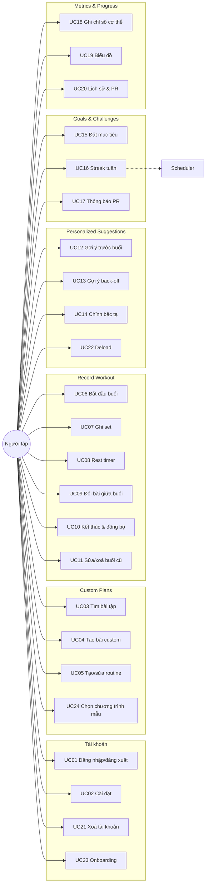

# SRS – Fitness Tracking and Training System

## 1. Giới thiệu

### 1.1 Mục đích

Tài liệu này đặc tả yêu cầu phần mềm (SRS) cho **Fitness Tracking and Training System** — ứng dụng theo dõi tập luyện, dùng làm đồ án môn Software Engineering và được xây dựng như một sản phẩm thật (MVP nhắm tới demo cuối kỳ dưới dạng web app di động — PWA — cài được lên màn hình chính iOS/Android, backend chạy localhost; beta công khai dời sang post-MVP). SRS là căn cứ để team thống nhất phạm vi trước khi bước vào thiết kế và lập trình.

*Cập nhật 16/11/2026:* nền tảng client đổi từ app Android native (React Native/Expo, chạy trên giả lập) sang PWA — xem 5.5 (D26).

### 1.2 Phạm vi sản phẩm

Ứng dụng web di động (PWA, dùng như app sau khi thêm vào màn hình chính) giúp người tập:

- Ghi lại buổi tập (tạ, reps, thứ tự bài) thay vì quên số liệu lần trước.
- Nhận gợi ý tăng tạ/rep, back-off, deload dựa trên dữ liệu đã log (progression engine).
- Tự nhập lịch tập có sẵn (tạo routine thủ công) hoặc chọn chương trình mẫu nếu chưa có; import lịch tập từ ảnh/text bằng LLM để post-MVP.
- Theo dõi chỉ số cơ thể, PR, tần suất tập (tích hợp Health Connect để post-MVP).
- Đặt mục tiêu và tự thách bản thân (streak, PR) dạng challenge.

Không thuộc phạm vi: dạy kỹ thuật tập từ đầu, huấn luyện viên AI, chấm điểm dinh dưỡng.

### 1.3 Định nghĩa, thuật ngữ, viết tắt

| Thuật ngữ | Định nghĩa |
| --- | --- |
| SRS | Software Requirements Specification |
| UC | Use Case |
| PR | Personal Record |
| RPE | Rate of Perceived Exertion — thang đánh giá độ gắng sức, tuỳ chọn |
| e1RM | Estimated 1-Rep Max — ước lượng mức tạ tối đa 1 lần đẩy |
| Routine | Lịch tập của riêng một user (bảng `ROUTINES`), gồm các ngày tập; mỗi user có tối đa một routine đang dùng. Xem `GLOSSARY.md` |
| Program | Chương trình mẫu do hệ thống soạn sẵn (YAML trong `packages/programs`, không lưu trong DB); chọn program tạo ra một routine mới |
| Load input | Quy ước ghi tạ của một bài (tổng / mỗi bên / mỗi quả / cột tạ) |
| STABLE | Buổi gần nhất có mọi working set cùng một mức tạ |
| TRANSITION | Buổi gần nhất có các working set khác mức tạ (đang chuyển mức) |
| Step | Bậc tạ nhỏ nhất tăng/giảm được, theo cùng quy ước với load input |
| Deload | Giai đoạn giảm tải có chủ đích để phục hồi |
| MVP | Minimum Viable Product — phạm vi bắt buộc cho demo cuối kỳ (PWA chạy trên trình duyệt di động, backend chạy localhost) |
| PWA | Progressive Web App — web app có manifest và service worker, thêm được vào màn hình chính và mở toàn màn hình như app |
| Post-MVP (Sau) | Phạm vi dời sang sau demo cuối kỳ; đặc tả vẫn giữ trong tài liệu để dùng khi triển khai (xem 3.3) |

### 1.4 Tài liệu tham khảo

- ACSM (American College of Sports Medicine), Position Stand *Progression Models in Resistance Training for Healthy Adults*, Medicine & Science in Sports & Exercise, 2009 — căn cứ cho ngưỡng tăng tạ (2–10% khi vượt số rep mục tiêu 1–2 rep) và cho chương trình mẫu.
- ACSM, Position Stand về resistance training, ấn bản 2026 — bản cập nhật lớn đầu tiên kể từ 2009; căn cứ bổ sung cho chương trình mẫu (D23).

### 1.5 Tổng quan tài liệu

Mục 2 mô tả tổng quan sản phẩm và người dùng. Mục 3–4 liệt kê và đặc tả chi tiết yêu cầu chức năng theo use case. Mục 5 nêu yêu cầu phi chức năng. Mục 6 nêu ràng buộc và giả định. Phụ lục tóm tắt business rules và glossary.

## 2. Mô tả tổng quan

### 2.1 Bối cảnh sản phẩm

Sản phẩm độc lập (không phụ thuộc hệ thống có sẵn nào của trường/công ty), chạy trên trình duyệt di động dưới dạng PWA — một codebase cho iOS (Safari/WebKit) và Android (Chrome); người dùng thêm vào màn hình chính để dùng như app. Tích hợp Health Connect (và HealthKit sau đó) là post-MVP và cần bọc PWA thành app native (Capacitor), vì web không truy cập được các API này. Giả thuyết định vị (cần kiểm chứng bằng phỏng vấn 5–10 người tập): người dùng thường **đã có sẵn lịch tập** (hay lấy từ mạng xã hội) và cần công cụ ghi lại, nhớ số liệu lần trước, biết khi nào nên tăng tạ — app không dạy tập từ đầu.

### 2.2 Actor

| Actor | Loại | Vai trò |
| --- | --- | --- |
| Người tập | Chính | Ghi buổi tập, nhận gợi ý, đặt mục tiêu, xem tiến độ |
| Health Connect / HealthKit | Hệ thống ngoài | Post-MVP, qua bản bọc native — cung cấp bước chân, cân nặng; nhận dữ liệu buổi tập |
| LLM service | Hệ thống ngoài | Post-MVP — đọc lịch tập từ ảnh/text khi import |
| Scheduler | Hệ thống nội bộ | Job định kỳ: đánh giá streak tuần (job kiểm tra link video chết là post-MVP, đi cùng UC31) |

### 2.3 Đặc điểm người dùng

- **Người tập có kinh nghiệm (persona chính):** đã tự tập lâu năm, có sẵn lịch tập, hiểu khái niệm rep range/set nhưng không nhất thiết quen RPE hay %1RM; muốn ghi nhanh, ít thao tác giữa các set.
- **Người mới (persona phụ):** chưa có lịch tập, cần chọn chương trình mẫu; video hướng dẫn kỹ thuật cho từng bài là post-MVP (UC31).
- Không thu thập thông tin tuổi ở onboarding; ứng dụng xác định không dành cho trẻ em (13+) — khai báo trong Play Console khi phát hành bản bọc native — nên không phân biệt UI theo nhóm tuổi.
- Người dùng được chia theo **bộ cài đặt mặc định** từ onboarding (mức độ hướng dẫn, khởi động, bật RPE) — không tách hẳn 2 chế độ giao diện, người dùng đổi được bất cứ lúc nào.

### 2.4 Chức năng tổng quan (theo nhóm yêu cầu đề bài)

| Nhóm | Mô tả ngắn |
| --- | --- |
| Custom plans | Tìm/tạo bài tập, tạo routine thủ công, chọn chương trình mẫu (import lịch tập và video hướng dẫn: post-MVP) |
| Record workout | Bắt đầu buổi, ghi set offline, rest timer, đổi bài giữa buổi, đồng bộ, sửa/xoá buổi cũ |
| Personalized suggestions | Gợi ý tăng tạ/rep, back-off trong buổi, khởi động, quay lại sau nghỉ, deload |
| Goals | Đặt mục tiêu PR / số buổi mỗi tuần / chỉ số cơ thể |
| Challenges | Đánh giá streak tuần, thông báo PR mới |
| Monitor metrics | Ghi chỉ số cơ thể |
| Progress presentation | Biểu đồ e1RM, volume theo nhóm cơ, tần suất; lịch sử và PR |
| Device integration | Post-MVP — kết nối và đồng bộ Health Connect qua bản bọc native (MVP không có use case thuộc nhóm này) |

### 2.5 Ràng buộc chung (tóm tắt, chi tiết ở mục 6)

PWA chạy trên trình duyệt di động (iOS + Android, một codebase), local-first cho phiên tập (IndexedDB + outbox, hoạt động offline), cài đặt bài tập, gợi ý và deload cũng local-first qua outbox; routine và catalog bài tập được cache chỉ đọc trên máy; các thao tác ghi khác cần mạng (xem 5.3, ADR 0002); progression engine chạy client-side. Chi tiết đầy đủ và các mục còn chưa chốt xem mục 6.

### 2.6 Giả định & phụ thuộc (tóm tắt)

Giả thuyết người dùng mục tiêu (2.1) chưa được kiểm chứng bằng phỏng vấn thật; các ngưỡng số của progression engine được chốt làm mặc định cho MVP, chỉnh lại sau nếu cần (xem Phụ lục — Business Rules).

## 3. Yêu cầu chức năng — Tổng quan

### 3.1 Danh sách use case

| ID | Use case | Nhóm | Phạm vi |
| --- | --- | --- | --- |
| UC01 | Đăng nhập / đăng xuất | – | MVP |
| UC02 | Cài đặt đơn vị (kg/lb), múi giờ | – | MVP |
| UC03 | Tìm bài tập theo tên EN/VI/alias | Custom plans | MVP |
| UC04 | Tạo bài tập tuỳ chỉnh | Custom plans | MVP |
| UC05 | Tạo/sửa routine thủ công | Custom plans | MVP |
| UC06 | Bắt đầu buổi tập từ routine hoặc tự do | Record workout | MVP |
| UC07 | Ghi set offline, xem số liệu lần trước | Record workout | MVP |
| UC08 | Rest timer | Record workout | MVP |
| UC09 | Thay bài, đổi thứ tự, superset trong buổi | Record workout | MVP |
| UC10 | Kết thúc và đồng bộ buổi tập | Record workout | MVP |
| UC11 | Sửa/xoá buổi tập cũ | Record workout | MVP |
| UC12 | Nhận gợi ý trước buổi | Personalized suggestions | MVP |
| UC13 | Nhận gợi ý back-off trong buổi | Personalized suggestions | MVP |
| UC14 | Chỉnh bậc tạ cho từng bài | Personalized suggestions | MVP |
| UC15 | Đặt mục tiêu | Goals | MVP |
| UC16 | Đánh giá streak tuần | Challenges | MVP |
| UC17 | Nhận thông báo PR mới | Challenges | MVP |
| UC18 | Ghi chỉ số cơ thể | Monitor metrics | MVP |
| UC19 | Xem biểu đồ e1RM, volume, tần suất | Progress presentation | MVP |
| UC20 | Xem lịch sử bài tập và PR | Progress presentation | MVP |
| UC21 | Rút quyền, xoá dữ liệu và tài khoản | – | MVP |
| UC22 | Bắt đầu/kết thúc deload | Personalized suggestions | MVP |
| UC23 | Onboarding | Goals/Custom plans | MVP |
| UC24 | Chọn chương trình mẫu | Custom plans | MVP |
| UC25 | Import lịch tập từ text/ảnh/khung hình video | Custom plans | Sau |
| UC26 | Review và sửa kết quả import | Custom plans | Sau |
| UC27 | Import từ file video (server trích khung hình) | Custom plans | Sau |
| UC28 | Kết nối Health Connect | Device integration | Sau |
| UC29 | Đồng bộ bước chân, cân nặng | Device integration | Sau |
| UC30 | Ghi buổi tập vào Health Connect | Device integration | Sau |
| UC31 | Xem video hướng dẫn kỹ thuật | Custom plans | Sau |

### 3.2 Use case diagram

*Ghi chú: các use case phạm vi "Sau" (post-MVP) — UC25 đến UC31, xếp cuối bảng 3.1 — không vẽ trong diagram; xem mục 3.3 và đặc tả gom ở mục 4.8.*

### 3.3 Phạm vi post-MVP

Cắt scope ngày 15/10/2026: bốn nhóm dưới đây dời khỏi MVP. Đặc tả của các use case liên quan được gom ở mục 4.8 để dùng lại khi triển khai.

| Nhóm dời | Thành phần dời sang post-MVP | Ảnh hưởng tới phần còn lại của MVP |
| --- | --- | --- |
| Import lịch tập bằng LLM | UC25, UC26, UC27 (UC27 vốn đã post-MVP); actor LLM service; ngưỡng hiệu năng import (5.1); quota và thời gian lưu dữ liệu import (5.2) | Onboarding (UC23) nhánh "đã có lịch tập" chuyển sang tạo routine thủ công (UC05) |
| Tích hợp Health Connect | UC28, UC29, UC30 (UC30 vốn đã post-MVP); actor Health Connect; adapter `DeviceProvider` (5.4); bọc PWA bằng Capacitor và phát hành trên Google Play (D26) | UC18 chỉ còn nguồn nhập thủ công; UC21 không còn bước thu hồi quyền Health Connect; nhóm Device integration của đề bài không có use case trong MVP |
| Video hướng dẫn kỹ thuật | UC31; job kiểm tra link video chết của Scheduler | Người mới chọn chương trình mẫu (UC24) nhưng chưa có video hướng dẫn trong app |
| Beta công khai (trước đây: closed test trên Google Play) | Deploy frontend và backend lên hosting HTTPS, kể cả yêu cầu đặt tại VN theo Nghị định 356/2025 (D20); privacy policy công khai. Các mục riêng của Google Play (form Data safety, Health apps declaration, trang web xoá tài khoản độc lập — D13) chỉ cần khi phát hành bản bọc native, đi cùng nhóm Health Connect | MVP kết thúc ở demo cuối kỳ (PWA, backend localhost — cách demo xem 6.1); xoá tài khoản trong app (UC21) vẫn thuộc MVP |

## 4. Đặc tả use case

### 4.1 Nhóm Tài khoản & cài đặt

#### UC01 — Đăng nhập / đăng xuất

- **Actor:** Người tập
- **Tiền điều kiện:** Đã mở web app (trong trình duyệt hoặc từ màn hình chính), có mạng cho lần đăng nhập đầu.
- **Luồng chính:**
  1. User chọn "Đăng nhập bằng Google" hoặc nhập email/mật khẩu.
  2. App gọi Supabase Auth để xác thực (Google đi qua redirect OAuth của trình duyệt), nhận JWT.
  3. Backend verify JWT ở mỗi request tiếp theo; nếu là lần đầu, tạo bản ghi `USERS`.
  4. App lưu phiên đăng nhập trong bộ nhớ trình duyệt (xem 5.2), chuyển vào màn hình chính (hoặc Onboarding nếu là user mới — UC23).
  5. Đăng xuất: xoá phiên cục bộ, quay về màn hình đăng nhập.
- **Luồng phụ:**
  - 1a. Đăng ký mới bằng email: xác nhận email trước khi đăng nhập lần đầu.
  - 2a. Xác thực thất bại (sai mật khẩu, mất mạng): hiện lỗi, cho thử lại.
- **Hậu điều kiện:** User có phiên hợp lệ để gọi các API cần xác thực.

#### UC02 — Cài đặt đơn vị (kg/lb), múi giờ

- **Actor:** Người tập
- **Tiền điều kiện:** Đã đăng nhập.
- **Luồng chính:**
  1. User vào màn hình Cài đặt, chọn đơn vị (kg/lb) và múi giờ.
  2. App cập nhật `USERS.unit_pref`, `USERS.timezone`.
  3. Toàn bộ số liệu hiển thị sau đó theo đơn vị mới; ranh giới tuần cho streak (UC16) dùng múi giờ mới.
- **Luồng phụ:** Đổi đơn vị không sửa dữ liệu gốc — `SET_LOGS.input_unit` giữ nguyên đơn vị lúc log (đảm bảo tính đúng của lịch sử/đồng bộ). Ở **tầng hiển thị**, toàn bộ số liệu log cũ được **quy đổi sang đơn vị mới** để xem (kg↔lb), tính theo `input_unit` gốc của từng dòng. **Chốt.**
- **Hậu điều kiện:** Cài đặt được lưu, áp dụng ngay.

#### UC21 — Rút quyền, xoá dữ liệu và tài khoản

- **Actor:** Người tập
- **Tiền điều kiện:** Đã đăng nhập.
- **Luồng chính:**
  1. User chọn "Xoá tài khoản" trong app. (Trang web xoá tài khoản độc lập — D13 — chỉ bắt buộc theo chính sách Google Play khi phát hành bản bọc native, post-MVP.)
  2. App yêu cầu xác nhận (nhập lại mật khẩu hoặc xác thực lại).
  3. Backend xoá cứng toàn bộ dữ liệu user theo cascade (USERS và mọi bảng liên quan).
  4. Xác nhận hoàn tất qua email hoặc màn hình thông báo.
- **Luồng phụ:** 1a. (Post-MVP, khi có UC28) User chỉ muốn rút quyền Health Connect mà không xoá tài khoản: xử lý riêng ở UC28 (thu hồi `DEVICE_CONNECTIONS`), không xoá dữ liệu khác.
- **Hậu điều kiện:** Toàn bộ dữ liệu user bị xoá vĩnh viễn, không khôi phục được.

### 4.2 Nhóm Custom Plans

#### UC03 — Tìm bài tập theo tên EN/VI/alias

- **Actor:** Người tập
- **Tiền điều kiện:** Đã đăng nhập.
- **Luồng chính:**
  1. User gõ từ khoá (EN, VI, hoặc alias tự đặt).
  2. App tìm trong `EXERCISES` qua `EXERCISE_ALIASES` (alias của user ưu tiên trước, rồi alias chung). Tìm trên catalog đã cache ở máy, khớp không dấu, nên chạy được khi offline; khi có mạng, server bổ sung fuzzy match (`pg_trgm`) nếu không khớp chính xác.
  3. Hiện danh sách kết quả kèm nhóm cơ, loại dụng cụ.
- **Luồng phụ:** 2a. Không tìm thấy: gợi ý tạo bài tập tuỳ chỉnh (UC04) — khi offline, báo cần có mạng để tạo.
- **Hậu điều kiện:** User chọn được bài để thêm vào routine hoặc buổi tập.

#### UC04 — Tạo bài tập tuỳ chỉnh

- **Actor:** Người tập
- **Tiền điều kiện:** Đã đăng nhập, có mạng (không hỗ trợ tạo bài tuỳ chỉnh khi offline — ADR 0002).
- **Luồng chính:**
  1. User nhập tên, nhóm cơ, loại dụng cụ, loại chỉ số (weight\_reps/reps/duration/distance).
  2. App tạo `EXERCISES` với `owner_id = user`, `source = 'user'`.
  3. Bài tập chỉ hiển thị cho user đó (không vào catalog chung).
- **Hậu điều kiện:** Bài tập vào catalog đã cache trên máy, dùng được ngay trong routine/buổi tập của user.

#### UC05 — Tạo/sửa routine thủ công

- **Actor:** Người tập
- **Tiền điều kiện:** Đã đăng nhập, có mạng (routine ghi thẳng lên server, không qua outbox — ADR 0002).
- **Luồng chính:**
  1. User tạo `ROUTINES` mới (`source = 'manual'`), đặt tên.
  2. Thêm các `ROUTINE_DAYS` (VD: Push A, Leg day), sắp thứ tự (`position`).
  3. Trong mỗi ngày, thêm `ROUTINE_EXERCISES`: chọn bài (UC03/UC04), đặt số set, rep range, tạ khởi điểm (nếu có), có bật khởi động không.
  4. Lưu routine; đặt làm routine đang dùng nếu muốn dùng ngay (mỗi user có tối đa một routine đang dùng). App cập nhật cache routine trên máy.
- **Luồng phụ:** Mất mạng: báo cần có mạng, không xếp hàng chờ đồng bộ. Sửa routine đang dùng không ảnh hưởng các buổi đã log trước đó (`SESSION_EXERCISES` đã snapshot `load_input` riêng).
- **Hậu điều kiện:** Routine sẵn sàng dùng cho UC06 (bắt đầu buổi).

#### UC24 — Chọn chương trình mẫu

- **Actor:** Người tập (thường là người mới, qua nhánh Onboarding — UC23)
- **Tiền điều kiện:** Đã đăng nhập, có mạng; có ít nhất một program phù hợp hồ sơ (`USER_PROFILES`: kinh nghiệm, số buổi/tuần, mục tiêu, thiết bị).
- **Luồng chính:**
  1. App lấy danh sách program từ server (server đọc YAML trong `packages/programs`) và đề xuất các program phù hợp `USER_PROFILES`.
  2. User xem chi tiết (số ngày, bài tập từng ngày), chọn một chương trình.
  3. Server tạo `ROUTINES`/`ROUTINE_DAYS`/`ROUTINE_EXERCISES` của user từ program (`source = 'program'`, `program_id` = id của program trong YAML); app cập nhật cache routine.
  4. User có thể chỉnh sửa ngay sau khi copy (UC05).
- **Hậu điều kiện:** User có một routine sẵn sàng dùng, độc lập với bản gốc.

### 4.3 Nhóm Record Workout

#### UC06 — Bắt đầu buổi tập từ routine hoặc tập tự do

- **Actor:** Người tập
- **Tiền điều kiện:** Đã đăng nhập.
- **Luồng chính:**
  1. User chọn một `ROUTINE_DAYS` từ routine đang dùng (đọc từ cache trên máy, chạy được khi offline), hoặc chọn "Tập tự do". App đề xuất sẵn **ngày kế tiếp**: ngày đứng sau ngày của buổi gần nhất (chưa xoá) theo routine đang dùng, quay vòng về ngày đầu; buổi tập tự do, buổi của routine khác hay của ngày đã xoá được bỏ qua (tập A, tập tự do, rồi tới B). Chưa có buổi nào theo routine thì là ngày đầu. User có routine nhưng không đặt cái nào đang dùng thì app dẫn sang tab Plans để chọn, vẫn tập tự do được. Đang có buổi dở thì không bắt đầu được buổi khác: Today đổi nút chính thành tiếp tục buổi đó, nút bắt đầu từng ngày ở tab Plans bị tắt.
  2. App tạo `WORKOUT_SESSIONS` mới trong bộ nhớ cục bộ IndexedDB (UUID sinh ở client); `routine_day_id` = ngày đã chọn hoặc `null` nếu tự do.
  3. App liệt kê các bài theo thứ tự trong `ROUTINE_DAYS` (hoặc rỗng nếu tự do, user tự thêm bài).
  4. Chuyển sang UC07 để bắt đầu ghi set.
- **Hậu điều kiện:** Có một session đang mở, sẵn sàng ghi set.

#### UC07 — Ghi set offline, xem số liệu lần trước

- **Actor:** Người tập
- **Tiền điều kiện:** Có một buổi tập đang mở (UC06).

**Luồng chính:**

1. Bắt đầu buổi tập: tạo session trong IndexedDB với UUID sinh ở client.
2. Mỗi bài hiện các set working của **lần tập gần nhất** cùng bài, kèm gợi ý (UC12) nếu có.
3. Ô nhập được điền sẵn từ gợi ý có kèm số (back-off, quay lại sau nghỉ, deload), nếu không thì từ lần trước; gợi ý tăng (R1) chỉ nêu hướng nên không làm đổi ô nhập. User xác nhận set → ghi `SET_LOGS` vào máy, thêm event vào outbox, bật rest timer (UC08).
4. Outbox đẩy lên server ngay khi có mạng (sau mỗi lần ghi, khi thiết bị online lại, khi app hiện lại trên màn hình): upsert idempotent theo `id`.
5. Client tính PR tạm để ăn mừng ngay; server là nguồn chuẩn, ghi `PERSONAL_RECORDS`.

- **Luồng phụ:**
  - Đóng tab hoặc hệ điều hành dừng app giữa buổi → khôi phục buổi đang dở từ IndexedDB.
  - Còn dữ liệu chưa đồng bộ → app hiện số set chưa đồng bộ để user biết (rủi ro trình duyệt xoá dữ liệu: xem 5.3).
  - Sửa set đã sync → cập nhật lại; xung đột xử lý last-write-wins.

* **Hậu điều kiện:** Set được lưu cục bộ ngay lập tức và đồng bộ lên server khi có mạng; PR tạm (nếu có) được thông báo trong app (UC17).

#### UC08 — Rest timer

- **Actor:** Người tập
- **Tiền điều kiện:** Đang trong một buổi tập, vừa log xong một set.
- **Luồng chính:**
  1. Ngay sau khi log set (UC07 bước 3), timer **tự động bắt đầu** đếm ngược theo `ROUTINE_EXERCISES.rest_seconds` (hoặc giá trị mặc định nếu bài không thuộc routine).
  2. Hết giờ: nếu app đang mở trên màn hình, app báo bằng âm thanh và hiệu ứng hình ảnh; rung chỉ dùng trên thiết bị hỗ trợ (Android — iOS không có Vibration API).
     - Timer tính theo **mốc thời điểm kết thúc**, không đếm tick: khi app bị đưa xuống nền hoặc khoá màn hình rồi mở lại, timer hiển thị đúng thời gian còn lại. Trong lúc ở nền app không báo được (trình duyệt tạm dừng JS).
     - Trong buổi tập, app giữ màn hình sáng bằng Screen Wake Lock nếu trình duyệt hỗ trợ.
     - Thông báo khi app ở nền (Web Push) là post-MVP. **Chốt (16/11/2026).**
  3. User có thể dừng/cộng thêm/bỏ qua timer bất cứ lúc nào.
- **Luồng phụ:** User tắt tự động bắt đầu **riêng cho từng bài** (ngay trên màn hình bài tập hoặc trong Cài đặt bài tập — UC14) → với bài đó, timer chờ user tự bấm. Lựa chọn lưu ở `USER_EXERCISE_SETTINGS.rest_auto_start` (theo user × bài), nên áp dụng được cả cho bài thêm ad hoc không thuộc routine. Mặc định bật cho mọi bài. Đổi được khi offline: thay đổi đi qua outbox như dữ liệu buổi tập (xem UC14). **Chốt.**
- **Hậu điều kiện:** Không chặn luồng ghi set — user log set tiếp theo được ngay cả khi timer chưa hết giờ.

#### UC09 — Thay bài, đổi thứ tự, superset trong buổi

- **Actor:** Người tập
- **Tiền điều kiện:** Đang trong một buổi tập.
- **Luồng chính:**
  1. User chọn một bài trong session, thao tác: thay bằng bài khác / kéo đổi thứ tự (`position`) / gộp superset (`superset_group`).
  2. **Thay bài:** app tạo/gán `SESSION_EXERCISES` mới cho bài mới, **bỏ liên kết `routine_exercise_id`** với bài gốc trong routine (session exercise trở thành "ad hoc", `routine_exercise_id = null`).
  3. Màn hình "lần trước" (UC07 bước 2) của bài mới **tính theo lịch sử của chính bài mới đó** — không kế thừa số liệu của bài đã bị thay ra.
  4. Đổi thứ tự/superset chỉ cập nhật `position`/`superset_group` của `SESSION_EXERCISES` trong buổi hiện tại, không ảnh hưởng `ROUTINE_EXERCISES` gốc.
- **Hậu điều kiện:** Buổi tập phản ánh đúng bài/thứ tự thực tế đã tập, độc lập với routine gốc.

#### UC10 — Kết thúc và đồng bộ buổi tập

- **Actor:** Người tập
- **Tiền điều kiện:** Có session đang mở.
- **Luồng chính:**
  1. User nhấn "Kết thúc buổi tập"; app ghi `ended_at`.
  2. Outbox đẩy toàn bộ set/session chưa sync lên server (`POST /sync/push`, upsert theo id).
  3. Server tính lại cache PR và streak liên quan.
  4. App kéo về thay đổi mới (`GET /sync/pull?since=cursor`).
- **Luồng phụ:** Không có mạng lúc kết thúc: session vẫn coi là "đã kết thúc" cục bộ, đồng bộ khi có mạng lại.
- **Hậu điều kiện:** Buổi tập được tính vào streak (UC16), volume, biểu đồ tiến độ (UC19).

#### UC11 — Sửa/xoá buổi tập cũ

- **Actor:** Người tập
- **Tiền điều kiện:** Có ít nhất một buổi tập đã kết thúc.
- **Luồng chính:**
  1. User mở lịch sử (UC20), chọn một buổi tập cũ.
  2. Sửa số liệu set hoặc xoá cả buổi.
  3. Xoá dùng tombstone (`deleted_at`), không xoá cứng ngay để còn đồng bộ.
  4. Server tính lại cache PR/streak liên quan đến buổi bị sửa/xoá (vì đây là dữ liệu dẫn xuất).
- **Hậu điều kiện:** Số liệu tổng hợp (PR, streak, biểu đồ) phản ánh đúng sau khi sửa.

### 4.4 Nhóm Personalized Suggestions

#### UC12 + UC13 — Nhận gợi ý trước buổi & back-off trong buổi

*(luật đầy đủ R1–R8 tóm tắt tại Phụ lục A)*

- **Trước buổi (`beforeSession`):**
  - Mọi working set đạt trần ở buổi gần nhất → gợi ý chung là nên tăng (tạ hoặc reps); không đề xuất mức cụ thể, user tự chọn và tự log số (R1).
  - User bỏ qua mà buổi sau vẫn đạt trần, hoặc vượt trần → chúc mừng và nhắc lại (R2).
  - Có thêm gợi ý khởi động (R5), quay lại sau thời gian nghỉ (R6), và deload khi sức mạnh tụt (R7).
- **Trong buổi (`afterSet`):** set vừa log chạm sàn hoặc dưới sàn rep range → gợi ý back-off về `max(W, current − step)` (R3).
  - `W` là trọng lượng đòn khi quy ước ghi tạ là `total`, các quy ước khác là 0; `current − step` là bậc ladder ngay dưới mức hiện tại (mức nằm trên ladder thì đúng bằng `current − step`; mức lệch ladder, vd kettlebell 10 kg bậc 4, thì xuống 8 kg chứ không làm tròn về 4 kg). Mức back-off không thấp hơn mức hiện tại (đã ở sàn) hoặc không còn set nào chờ tập thì không gợi ý.
  - Back-off nêu một mức tạ cụ thể nên có `strength = strong`, ghi với `session_exercise_id` của bài trong buổi; các set còn lại điền sẵn mức back-off.
  - Vòng đời: đưa ra ở `pending`; "OK, X kg" là `accepted`; "Keep Y kg" là `dismissed` và ô tạ trở về mức cũ; ghi set kế mà chưa trả lời thì ghi đúng mức back-off là `accepted`, mức khác là `dismissed`; kết thúc buổi mà còn `pending` là `expired`.
  - Các set chờ tập điền mức back-off (hoặc mức cũ sau "Keep") cho tới khi user tự ghi một set sau đó ở mức tạ khác; từ đó các set sau điền như thường. Xoá set gây back-off khi gợi ý còn `pending` thì bỏ gợi ý (tombstone, không tính vào tỉ lệ chấp nhận); Undo việc xoá thì gợi ý quay lại.
- Nhận biết R2 từ số liệu: hai buổi gần nhất của bài đều đạt trần ở mọi working set, cùng mức tạ và cùng quy ước ghi tạ; buổi sau đã lên tạ mà vẫn đạt trần thì là R1. R4 không lưu thành gợi ý: chỉ bỏ R1, điền sẵn đúng từng set của buổi trước và nhắc ngắn cạnh số liệu lần trước.
- Vòng đời gợi ý trước buổi: bắt đầu buổi (hoặc thêm bài ad hoc) thì ghi các gợi ý của bài ở trạng thái `pending`; "Got it" (ở Today hay màn ghi set) là `accepted`; ghi set đầu của bài mà chưa trả lời là `dismissed`; kết thúc buổi mà còn `pending` là `expired`. Trả lời ở Today trước khi vào buổi thì ghi luôn bản ghi đã trả lời, không tạo bản thứ hai. Mỗi gợi ý ứng với một bài và một lần tập làm căn cứ (`based_on_session_exercise_id`).
- Mọi gợi ý đều kèm lý do (`reason`) và user có quyền bỏ qua (`status = dismissed`). Tỉ lệ chấp nhận gợi ý (`SUGGESTIONS.status`) là metric đánh giá engine. Gợi ý và trạng thái của nó được ghi vào máy rồi đẩy lên qua outbox (UUID sinh ở client), nên chạy được khi offline.
- Engine đọc input (target của routine, cài đặt bài tập, lịch sử deload, các buổi gần nhất) từ dữ liệu trên máy, không gọi mạng.

#### UC14 — Chỉnh bậc tạ cho từng bài

- **Actor:** Người tập
- **Tiền điều kiện:** Đang xem một bài tập (trong buổi tập hoặc trong thư viện bài tập).
- **Luồng chính:**
  1. User mở Cài đặt bài tập, đổi step, quy ước ghi tạ (`load_input`), trọng lượng đòn (barbell), hoặc bật/tắt tự động rest timer.
  2. App lưu vào `USER_EXERCISE_SETTINGS` (`weight_step_kg`, `load_input`, `bar_weight_kg`, `rest_auto_start`) riêng cho user + bài đó. Cả dòng được ghi vào máy rồi đẩy lên qua outbox (upsert theo khoá user × bài, last-write-wins), nên chỉnh được cả khi offline, trong hay ngoài buổi tập.
  3. Các luật có nêu số (R3 back-off, R5 khởi động, R6 quay lại sau nghỉ, R7 deload) làm tròn theo step/quy ước mới; user chưa đặt thì dùng mặc định theo loại dụng cụ.
- **Hậu điều kiện:** Tuỳ chỉnh áp dụng cho mọi gợi ý có nêu số của bài đó. R1/R2 chỉ nêu hướng tăng nên không dùng step.

#### UC22 — Bắt đầu / kết thúc giai đoạn deload

*(chi tiết luật R7 tại Phụ lục A)*

- **Actor:** Người tập
- **Tiền điều kiện:** Đã đăng nhập; có thể có hoặc không có gợi ý deload đang chờ.
- **Luồng chính:**
  1. Deload được kích hoạt theo 1 trong 2 cách: (a) engine phát hiện tín hiệu (reps giảm ≥ 2 ở cùng mức tạ, ≥ 2 bài, 2 buổi liên tiếp) và gợi ý; hoặc (b) user tự bắt đầu bất cứ lúc nào, kể cả tự báo mệt lúc check-in đầu buổi.
  2. User chọn chế độ (`rest_full`/`rest_half`/`half_load`/`half_reps`/`half_both`) và số ngày; mặc định điền sẵn theo lần deload gần nhất (`DELOAD_PERIODS`), user sửa được.
  3. App tạo `DELOAD_PERIODS` với `source = suggested` hoặc `manual` — ghi vào máy rồi đẩy lên qua outbox (UUID sinh ở client), nên bắt đầu/kết thúc deload được cả khi offline.
  4. Trong giai đoạn deload: target các bài đổi theo chế độ đã chọn; streak tuần tạm dừng, không tính trượt; R1/R2/R7 tạm tắt.
  5. Hết số ngày (hoặc user chủ động kết thúc sớm): `end_date` được chốt, quay lại target trước khi deload.
- **Hậu điều kiện:** Lịch sử `DELOAD_PERIODS` được dùng để tính khoảng nghỉ thực tế cho R6 (loại trừ ngày deload) và làm mặc định cho lần deload sau.

### 4.5 Nhóm Goals & Challenges

#### UC15 — Đặt mục tiêu

- **Actor:** Người tập
- **Tiền điều kiện:** Đã đăng nhập.
- **Luồng chính:**
  1. User chọn loại mục tiêu: `pr_target` (VD: bench 100kg), `weekly_frequency` (số buổi/tuần), hoặc `body_metric` (VD: giảm còn 70kg).
  2. Nhập giá trị đích (`target_value`), hạn hoàn thành (`deadline`, tuỳ chọn), bài tập liên quan nếu là `pr_target`.
  3. App tạo `GOALS` với `status = active`.
  4. Hệ thống tự cập nhật `status = achieved` khi số liệu thực tế (PR mới, streak, chỉ số cơ thể) đạt `target_value`.
- **Luồng phụ:** User huỷ mục tiêu giữa chừng → `status = abandoned`.
- **Hậu điều kiện:** Mục tiêu xuất hiện trong màn hình Goals, được theo dõi tự động.

#### UC16 — Đánh giá streak tuần (Scheduler)

- Cuối mỗi tuần (theo `timezone` của user): đếm số buổi tập hoàn thành. Nếu ≥ `target_value` thì streak +1, ngược lại reset về 0; cập nhật `best_streak`.
- Tuần nằm trong giai đoạn deload thì streak **tạm dừng**, không tính là trượt.
- **Luôn tính lại từ dữ liệu gốc (sessions), không cộng dồn** — vì buổi tập offline có thể sync trễ vào một tuần đã đánh giá; tính lại từ gốc cho kết quả idempotent.
- Ranh giới tuần: từ 00:00 thứ Hai đến hết Chủ nhật theo múi giờ của user (quy ước ISO 8601). **Chốt.**

#### UC17 — Nhận thông báo PR mới

- **Actor:** Người tập
- **Tiền điều kiện:** Đang log set trong một buổi tập.
- **Luồng chính:**
  1. Set vừa log tạo ra PR mới theo tính toán tạm ở client (UC07 bước 5).
  2. App hiện **thông báo trong app** ngay trên màn hình buổi tập: tên bài, loại PR (e1RM / weight\_at\_reps / max\_reps / session\_volume) và giá trị mới.
  3. User bấm vào thông báo → mở màn hình lịch sử/PR của bài đó (UC20).
  4. Khi sync, server tính lại và là nguồn chuẩn; nếu server không công nhận PR (hiếm, ví dụ set bị sửa sau đó), PR được gỡ khỏi `PERSONAL_RECORDS` mà không thông báo thêm.
- **Cách tính PR** (hàm thuần trong `packages/engine`, client và server dùng chung — D7). **Chốt (25/11/2026).**
  - Chỉ so working set chưa xoá của **cùng bài và cùng `load_input`** (D15). Chưa có buổi nào đã kết thúc của bài với cùng `load_input` thì không có PR, kể cả khi set sau vượt set trước trong buổi đầu. Phải **vượt hẳn** kỷ lục; bằng thì không tính.
  - Theo set, mỗi kiểu bài một loại (DESIGN.md › PR theo kiểu bài): tạ × reps → `e1rm` (Epley); bài reps có tạ đeo thêm > 0 → `weight_at_reps`: tạ nặng hơn mọi set có tạ đeo thêm với **ít nhất N reps** (N = reps của set); bài reps ở BW (0 kg / không tạ) → `max_reps`, so với các set BW. Bài bấm giờ, quãng đường chưa có loại PR.
  - `session_volume`: tổng tạ × reps các working set của bài trong buổi (bài reps: tổng reps), so với buổi cao nhất trước đó. Báo **một lần**, ở set đẩy tổng qua kỷ lục. Đây là volume của một bài trong một buổi, khác "Volume (theo nhóm cơ)" ở Phụ lục tính bằng số set.
  - Một set lập nhiều PR thì thông báo PR theo set trước, `session_volume` sau. Trên màn buổi tập, dải số áo đổi sang nền mực trong 2,4 giây với tên bài và số mới; hàng set ghi loại PR tới khi user chạm vào.
- **Phạm vi:** MVP chỉ có thông báo trong app. Push notification (Web Push) để post-MVP: PR chỉ phát sinh khi user đang log trong app, trong khi Web Push cần HTTPS, quyền thông báo, và trên iOS chỉ hoạt động khi app đã được thêm vào màn hình chính (iOS 16.4+). **Chốt.**
- **Hậu điều kiện:** User thấy PR ngay khi đạt, không cần rời màn hình buổi tập.

### 4.6 Nhóm Monitor Metrics & Progress Presentation

#### UC18 — Ghi chỉ số cơ thể

- **Actor:** Người tập
- **Tiền điều kiện:** Đã đăng nhập.
- **Luồng chính:**
  1. User nhập thủ công một chỉ số (`weight`/`body_fat`/`waist`) và thời điểm đo.
  2. App lưu `BODY_METRICS` với `source = manual`.
  3. (Post-MVP, khi có UC29) Nếu chỉ số trùng loại và thời điểm với dữ liệu đồng bộ từ Health Connect (UC29, `source = health_connect`), giữ cả hai bản ghi riêng (không merge) — phân biệt qua `source`.
- **Hậu điều kiện:** Chỉ số xuất hiện trong biểu đồ tiến độ (UC19) và có thể dùng làm mục tiêu `body_metric` (UC15).

#### UC19 — Xem biểu đồ e1RM theo bài, số set mỗi tuần theo nhóm cơ, tần suất tập

- **Actor:** Người tập
- **Tiền điều kiện:** Có ít nhất một buổi tập đã log.
- **Luồng chính:**
  1. **Biểu đồ e1RM theo bài:** với mỗi buổi có log bài đó, tính e1RM từ set nặng nhất bằng công thức **Epley** (`e1RM = weight × (1 + reps/30)`); vẽ theo thời gian.
  2. **Số set mỗi tuần theo nhóm cơ:** đếm working set đã log, join qua `EXERCISE_MUSCLES` để quy về `MUSCLES.muscle_group`; đo bằng **số set**, không cộng tổng kg (vì quy ước ghi tạ khác nhau giữa các bài — D16).
  3. **Tần suất tập:** số buổi hoàn thành mỗi tuần/tháng, dựa trên `WORKOUT_SESSIONS.ended_at`.
- **Luồng phụ:** Bài đổi `load_input` giữa các buổi (VD: đổi cách ghi tạ đơn) → chỉ so sánh e1RM trong cùng một `load_input`, không gộp lẫn (theo D15 — quy ước ghi tạ riêng từng bài).
- **Hậu điều kiện:** User thấy xu hướng tiến bộ theo thời gian.

#### UC20 — Xem lịch sử bài tập và PR

- **Actor:** Người tập
- **Tiền điều kiện:** Có ít nhất một buổi tập đã log.
- **Luồng chính:**
  1. User xem danh sách buổi tập theo thời gian (mới nhất trước), lọc theo bài tập hoặc khoảng ngày.
  2. Mở một buổi → xem chi tiết set đã log.
  3. Xem riêng danh sách `PERSONAL_RECORDS` theo bài, theo loại PR.
- **Hậu điều kiện:** Là điểm vào để sửa/xoá buổi cũ (UC11).

### 4.7 Onboarding

#### UC23 — Onboarding: trả lời vài câu hỏi → đặt bộ mặc định và chọn nhánh đi tiếp

- **Actor:** Người tập (mới đăng ký)
- **Tiền điều kiện:** Vừa hoàn tất UC01 lần đầu.
- **Luồng chính:**
  1. App hỏi một chuỗi câu hỏi ngắn: mức độ kinh nghiệm, đã có lịch tập sẵn chưa, số buổi/tuần dự kiến, thời gian mỗi buổi, thiết bị tập (gym/nhà), mục tiêu chung. Không hỏi tuổi (D25).
  2. Lưu vào `USER_PROFILES` (`experience_level`, `has_routine`, `sessions_per_week`, `session_minutes`, `equipment_access`, `goal`).
  3. Dựa trên câu trả lời, app đặt **bộ cài đặt mặc định** (mức độ hướng dẫn, bật/tắt khởi động mặc định, bật/tắt RPE mặc định) — D22. Đồng thời tạo sẵn một mục tiêu số buổi mỗi tuần (weekly\_frequency, UC15) với giá trị bằng số buổi/tuần vừa khai báo, làm mốc cho streak tuần (UC16); user sửa hoặc xoá được. **Chốt.**
  4. Rẽ nhánh: đã có lịch tập → chuyển sang Tạo routine thủ công (UC05) để tự nhập lịch (import từ ảnh/text — UC25 — là post-MVP); chưa có → chuyển sang Chọn chương trình mẫu (UC24).
- **Luồng phụ:** User bỏ qua onboarding → dùng bộ mặc định chung, vào thẳng màn hình chính, có thể vào lại Cài đặt để đổi từng mục.
- **Hậu điều kiện:** User có `USER_PROFILES` đầy đủ và một routine ban đầu (tạo thủ công hoặc từ program).

### 4.8 Đặc tả use case post-MVP

Các use case UC25–UC31 thuộc phạm vi Sau, dời khỏi MVP ngày 15/10/2026 (xem 3.3). Đặc tả được giữ lại để dùng khi triển khai; phần chưa thảo luận được ghi rõ trong từng mục.

#### UC25 + UC26 — Import lịch tập & Review kết quả import — *post-MVP*

- **Tiền điều kiện:** đã đăng nhập.
- **Luồng chính:**
  1. User chọn nguồn: dán text / chọn 1..N ảnh / chia sẻ vào app từ ứng dụng khác.
  2. App upload; server tạo `IMPORT_JOBS` với status `pending`.
  3. Server gọi LLM với JSON schema cố định (ngày tập → bài → số set, rep range, ghi chú).
  4. Khớp tên bài: alias của user → alias chung → fuzzy (`pg_trgm`) → LLM chọn trong top-k ứng viên.
  5. Job chuyển `parsed`; app hiện màn hình review.
  6. User sửa và xác nhận → tạo `ROUTINES`, `ROUTINE_DAYS`, `ROUTINE_EXERCISES` trong một transaction; mỗi lần sửa tên bài được khớp sẽ lưu thành `EXERCISE_ALIASES` (owner = user); xoá media gốc.
- **Luồng phụ:**
  - Mất mạng: đưa vào hàng đợi, xử lý khi có mạng lại.
  - LLM lỗi/timeout: retry 1 lần, sau đó chuyển `failed` và gợi ý nhập tay (UC05).
  - Không khớp được tên bài: đánh dấu "chưa khớp"; user chọn bài có sẵn hoặc tạo bài custom (UC04).
- **Hậu điều kiện:** Routine chỉ được tạo sau khi user xác nhận.

#### UC27 — Import từ file video (server trích khung hình) — *post-MVP*

- **Phạm vi:** Sau (không thuộc MVP). Đặc tả chi tiết (cách trích khung hình, tần suất, giới hạn độ dài video) **chưa được thảo luận**, sẽ bổ sung khi lên kế hoạch cho giai đoạn sau MVP.
- **Ghi chú tạm:** dự kiến tái dùng chung pipeline import với UC25 (worker trích khung hình → OCR/vision LLM → cùng luồng khớp tên bài).

#### UC28 — Kết nối Health Connect (cấp quyền) — *post-MVP*

- **Actor:** Người tập, Health Connect
- **Tiền điều kiện:** User dùng bản bọc native (Capacitor) của app trên thiết bị Android có cài Health Connect — bản PWA không truy cập được Health Connect (D26).
- **Luồng chính:**
  1. User vào Cài đặt, chọn "Kết nối Health Connect".
  2. App yêu cầu quyền đọc bước chân, cân nặng (và ghi buổi tập, cho UC30 giai đoạn sau).
  3. User cấp quyền qua hộp thoại hệ thống Android.
  4. App lưu `DEVICE_CONNECTIONS` (`provider = health_connect`, `granted_scopes`, `status = connected`).
- **Luồng phụ:** User từ chối một phần quyền → chỉ đồng bộ phần được cấp; user rút quyền sau đó (từ Cài đặt Android hoặc trong app) → `status` cập nhật lại, dừng đồng bộ.
- **Hậu điều kiện:** Sẵn sàng cho UC29.

#### UC29 — Đồng bộ bước chân, cân nặng từ Health Connect — *post-MVP*

- **Actor:** Health Connect, Scheduler
- **Tiền điều kiện:** Đã kết nối (UC28) với quyền đọc tương ứng.
- **Luồng chính:**
  1. Định kỳ (hoặc khi mở app), app đọc dữ liệu mới từ Health Connect kể từ `sync_cursor`.
  2. Bước chân → `DAILY_ACTIVITIES` (unique theo `user_id, day, source`); cân nặng → `BODY_METRICS` (`source = health_connect`, dedupe theo `external_id`).
  3. Cập nhật `sync_cursor`, `last_sync_at`.
- **Luồng phụ:** Trùng dữ liệu do đồng bộ nhiều lần → dedupe theo unique constraint, không tạo bản ghi mới.
- **Hậu điều kiện:** Dữ liệu tổng hợp (không lưu nhịp tim thô hay dữ liệu chi tiết khác) sẵn sàng hiển thị cùng tiến độ tập luyện.

#### UC30 — Ghi buổi tập vào Health Connect — *post-MVP*

- **Phạm vi:** Sau (không thuộc MVP). Mapping loại bài tập của app sang loại exercise của Health Connect **chưa được xác định**, cần bổ sung khi triển khai.
- **Ghi chú tạm:** dự kiến ghi lại qua `WORKOUT_SESSIONS.health_external_id` (field đã có sẵn trong schema) sau khi kết thúc buổi (UC10).

#### UC31 — Xem video hướng dẫn kỹ thuật của một bài — *post-MVP*

- **Actor:** Người tập
- **Tiền điều kiện:** Bài tập có ít nhất một bản ghi `EXERCISE_VIDEOS` còn hoạt động.
- **Luồng chính:**
  1. User nhấn "Xem hướng dẫn" trên một bài tập.
  2. App chọn video ưu tiên tiếng Việt, `is_primary = true`.
  3. App mở link YouTube của video (hệ điều hành chuyển sang ứng dụng YouTube nếu đã cài), không nhúng player.
- **Luồng phụ:** Không có video tiếng Việt: hiện video tiếng Anh nếu có. Link chết (cron kiểm tra định kỳ đã đánh dấu): ẩn nút hoặc báo "chưa có video".
- **Hậu điều kiện:** User rời app sang YouTube; không ảnh hưởng phiên tập đang mở (nếu đang trong buổi tập).

## 5. Yêu cầu phi chức năng

### 5.1 Hiệu năng

Các ngưỡng dưới đây là mốc tối thiểu, đã chốt cho MVP:

| Yêu cầu | Ngưỡng đề xuất | Trạng thái |
| --- | --- | --- |
| Ghi 1 set (offline) | Không chờ mạng, ghi tức thời vào IndexedDB | **Chốt** |
| Đồng bộ outbox khi có mạng | Hoàn tất trong vài giây cho một buổi tập thông thường (\~20–30 set) | **Chốt** |
| Import lịch tập (LLM) — post-MVP | Job `parsed` trong vài chục giây; nếu lâu hơn, app cho phép rời màn hình và quay lại xem sau | **Chốt** |
| Tải danh sách bài tập/tìm kiếm | Phản hồi gần như tức thời — tìm trên catalog đã cache ở máy (dữ liệu tương đối nhỏ, \~150–250 bài) | **Chốt** |

### 5.2 Bảo mật & riêng tư dữ liệu

- Auth qua Supabase Auth (Google + email/mật khẩu, đều thuộc MVP); backend chỉ verify JWT, không tự quản mật khẩu.
- Phiên đăng nhập trên web lưu ở `localStorage` (mặc định của supabase-js), vì trình duyệt không có kho bảo mật như secure-store của app native. Rủi ro script độc (XSS) đọc được token được giảm bằng Content-Security-Policy chặn script lạ.
- (Post-MVP, khi có UC28/UC29) Chỉ lưu dữ liệu **tổng hợp** từ Health Connect (bước/ngày, cân nặng); **không lưu nhịp tim thô** hay dữ liệu sức khoẻ chi tiết khác.
- (Post-MVP, cùng UC25/UC26) Xoá media ảnh/video dùng để import ngay sau khi user xác nhận kết quả (UC25/UC26).
- Xoá tài khoản (UC21) = xoá cứng toàn bộ dữ liệu liên quan theo cascade, không giữ lại bản sao.
- MVP: xoá tài khoản trong app. Trang web xoá tài khoản độc lập (D13) chỉ bắt buộc theo chính sách Google Play khi phát hành bản bọc native — post-MVP.
- Hosting cho beta công khai dự kiến đặt tại VN nhằm tránh thủ tục chuyển dữ liệu cá nhân xuyên biên giới theo Nghị định 356/2025 — **post-MVP — MVP chạy backend trên localhost nên chưa cần hosting; vị trí VN chỉ bắt buộc khi có người dùng thật ở beta. Đề xuất, chưa chốt (D20)**.
- Không gắn SDK crash/analytics bên thứ 3 cho beta (D21). Thông báo PR (UC17) ở MVP là thông báo trong app, không cần dịch vụ đẩy.

* **Quota import \[Đề xuất, post-MVP\]:** tối đa 5 lần import mỗi user mỗi ngày, để chặn chi phí LLM.
* **Thời gian lưu dữ liệu import \[Đề xuất, post-MVP\]:** media của job không được xác nhận bị xoá sau 7 ngày; `IMPORT_JOBS.llm_output` giữ 90 ngày để đo độ chính xác parser rồi xoá.
* **Tuân thủ khi phát hành — post-MVP:** beta web công khai cần privacy policy công khai (pháp luật VN về bảo vệ dữ liệu cá nhân áp dụng khi có người dùng thật); demo MVP không cần. Form Data safety và Health apps declaration trong Play Console chỉ cần khi phát hành bản bọc native lên Google Play.

### 5.3 Khả dụng offline

- Toàn bộ luồng ghi buổi tập (UC06–UC11) hoạt động không cần mạng: IndexedDB + outbox, UUID sinh ở client, đồng bộ khi có mạng lại bằng upsert idempotent.
- Ngoài dữ liệu buổi tập, ba loại dữ liệu sau cũng local-first — lưu trên máy, ghi qua outbox, kéo về bằng sync — dù được sửa từ màn nào (trong buổi tập, thư viện bài tập hay màn deload): cài đặt bài tập (`USER_EXERCISE_SETTINGS`, UC08/UC14), gợi ý và trạng thái gợi ý (`SUGGESTIONS`, UC12/UC13), giai đoạn deload (`DELOAD_PERIODS`, UC22). Lý do: chúng thường phát sinh ngay lúc tập, có thể đúng lúc mất mạng.
- Routine (kèm ngày tập và bài) và catalog bài tập — engine và màn bắt đầu buổi cần chúng khi offline — được **cache chỉ đọc** trên máy và làm mới khi có mạng. Tìm bài khi offline khớp không dấu trên catalog đã cache.
- Các thao tác ghi khác ngoài buổi tập (tạo/sửa routine, chọn program, tạo bài tuỳ chỉnh, alias, cài đặt tài khoản, mục tiêu, chỉ số cơ thể, onboarding) cần mạng: app báo cần có mạng, không xếp hàng chờ đồng bộ. Lý do và đánh đổi: ADR 0002.
- App mở được khi không có mạng: service worker cache phần vỏ app (HTML/JS/CSS); dữ liệu không đi qua service worker.
- Đồng bộ được kích hoạt sau mỗi lần ghi, khi thiết bị online lại và khi app hiện lại trên màn hình — không dựa vào Background Sync API vì Safari không hỗ trợ.
- **Chống mất dữ liệu chưa đồng bộ:** trình duyệt (đặc biệt Safari/iOS) có thể xoá bộ nhớ của site lâu không dùng nếu chưa được thêm vào màn hình chính; trên iOS, bộ nhớ của tab Safari còn tách biệt với app trên màn hình chính. Biện pháp:
  1. App xin trình duyệt giữ dữ liệu lâu dài (`navigator.storage.persist()`) — trình duyệt tự quyết, thường không hỏi user.
  2. Đẩy outbox ngay khi có mạng, không đợi kết thúc buổi.
  3. Trên iOS, nếu đang mở trong tab trình duyệt, app hiện hướng dẫn "Thêm vào màn hình chính" trước khi bắt đầu tập (gợi ý, không chặn).
  4. Hiện số set chưa đồng bộ.
- Progression engine (R1–R8) là pure function chạy trên client, không gọi mạng, không đọc đồng hồ hệ thống (nhận `today` qua input); input lấy từ dữ liệu trên máy.
- (Post-MVP) Import (UC25) và các tính năng phụ thuộc LLM/Health Connect thì cần mạng; mất mạng giữa chừng được đưa vào hàng đợi xử lý sau.

### 5.4 Khả năng mở rộng & bảo trì

- Backend là modular monolith (NestJS + 1 worker) chạy trên localhost ở MVP, lên một server khi làm beta công khai — đủ cho quy mô đó, không đặt mục tiêu chịu tải lớn ở giai đoạn này.
- Monorepo tách `packages/engine` (business rule), `packages/contract` (schema Zod dùng chung cho client và server) và `packages/programs` (program dạng YAML) để đổi luật hoặc API không phá vỡ phần còn lại.
- Thiết kế `DeviceProvider` adapter (post-MVP, cùng UC28/UC29, chạy trong bản bọc native) để thêm HealthKit (iOS) sau mà không đổi luồng tích hợp thiết bị.

### 5.5 Tương thích nền tảng

- **MVP là PWA, một codebase cho iOS và Android. Chốt (D26, 16/11/2026 — thay D5).** Chạy trên Safari (iOS 16.4+; từ iOS 26 mọi trang thêm vào màn hình chính đều mở như web app) và Chrome (Android). Trên iOS mọi trình duyệt, kể cả Chrome, đều dùng engine WebKit, nên khác biệt cần xử lý là giữa iOS và Android chứ không phải giữa tên trình duyệt. Thiết kế theo giới hạn của iOS và dùng *feature detection* thay vì tách code:

| Khác biệt | Android (Chrome) | iOS (WebKit) | Cách xử lý |
| --- | --- | --- | --- |
| Cài lên màn hình chính | Có lời mời cài tự động | User tự thêm qua Share → Thêm vào màn hình chính | Màn hướng dẫn riêng cho iOS |
| Rung (UC08) | Có | Không | Âm thanh + hiệu ứng hình ảnh |
| Xoá bộ nhớ của site | Hiếm | Có thể xảy ra khi chưa thêm vào màn hình chính | Biện pháp ở 5.3 |
| Web Push (post-MVP) | Có | Chỉ khi đã thêm vào màn hình chính | — |

- Lý do đổi: team không có Mac nên bản native chỉ làm được Android; PWA phủ cả iOS ngay ở MVP, và không cần giả lập hay Play Store để demo. Đánh đổi: nhóm Device integration (Health Connect/HealthKit) không làm được trên web — giữ làm post-MVP bằng cách bọc PWA thành app native (Capacitor), dùng lại code web.
- Không dùng SDK quảng cáo hay theo dõi bên thứ 3 ngoài phạm vi đã liệt kê ở 5.2.

### 5.6 Ngôn ngữ

- Giao diện có hai ngôn ngữ, tiếng Anh và tiếng Việt, ngay từ MVP. Tiếng Anh là ngôn ngữ mặc định; user đổi ngôn ngữ trong phần cài đặt cá nhân, lựa chọn được giữ khi đăng nhập trên máy khác. (Chốt D27, 19/11/2026; dự kiến đổi mặc định sang tiếng Việt sau.)
- Mọi chữ hiển thị (nhãn, thông báo, lý do gợi ý, thông báo lỗi) có đủ cả hai bản. Tên bài tập và nhóm cơ trong catalog có cả tên tiếng Anh và tiếng Việt; tìm bài khớp được cả hai tên và alias. Dữ liệu do user tự nhập không được dịch.
- Số và ngày hiển thị theo quy ước của ngôn ngữ đang dùng (tiếng Việt: 77,5 kg; tiếng Anh: 77.5 kg); ô nhập số chấp nhận cả dấu phẩy lẫn dấu chấm.
- Thiết kế kỹ thuật: SDD 3.5.

## 6. Ràng buộc thiết kế, giả định & phụ thuộc

Các quyết định kiến trúc/kỹ thuật (nền tảng cụ thể, backend, hosting, cấu trúc repo, cơ chế đồng bộ, hàng đợi import...) được lùi sang tài liệu SDD sắp tới, không liệt kê lại ở đây — SRS chỉ giữ ràng buộc/yêu cầu đã thể hiện xuyên suốt mục 2–5.

### 6.1 Giả định

- Nhu cầu "có sẵn lịch tập, cần công cụ ghi + gợi ý" là **trải nghiệm thật của chính founder**, không phải giả thuyết suông; phần còn cần kiểm chứng là mức độ phổ biến của nhu cầu này ở người dùng khác — cần phỏng vấn 5–10 người tập để xác nhận, ảnh lịch tập thu được dùng làm bộ test cho UC25 khi triển khai import (post-MVP).
- Nhiều ngưỡng số của progression engine (backoff RPE threshold, ngưỡng deload, số ngày nghỉ coi là "break"...) ban đầu là đề xuất của Claude, nay **chốt làm mặc định cho MVP**, chỉnh lại sau nếu cần — xem Phụ lục.
- Cách chạy demo cuối kỳ **chưa chốt**, tuỳ tiến độ:
  - (a) Chrome desktop ở chế độ giả lập mobile.
  - (b) Frontend deploy lên host HTTPS, backend localhost mở ra ngoài qua tunnel, để cài PWA trên điện thoại thật.
  - (c) Deploy cả backend — ưu tiên nếu kịp.

  Service worker và cài PWA cần HTTPS (trừ `localhost`), nên URL API và danh sách origin được phép phải cấu hình qua biến môi trường để cả ba cách đều làm được.
- UC27 và UC30 giả định tái dùng hạ tầng đã có (pipeline import, `health_external_id`) nhưng chi tiết luồng chưa được xác nhận.

### 6.2 Phụ thuộc bên ngoài

- Supabase Auth (xác thực), một LLM provider qua adapter (import — post-MVP), Health Connect (Android, qua bản bọc native — post-MVP), Web Push của trình duyệt (chỉ khi làm push cho UC17 ở post-MVP), Google Play (chỉ khi phát hành bản bọc native — post-MVP).

## Phụ lục

### A. Business Rules Reference

| Luật | Tóm tắt | Áp dụng cho |
| --- | --- | --- |
| R1 | Mọi working set đạt ≥ rep\_max ở buổi STABLE → gợi ý **chung chung**: nên tăng. Không đề xuất mức cụ thể — user tự chọn tăng tạ hay tăng reps, tự nhập số khi log | UC12 |
| R2 | Bỏ qua R1 mà vẫn đạt/vượt trần buổi sau → chúc mừng + nhắc lại | UC12 |
| R3 | Reps dưới rep\_min (hoặc = rep\_min tuỳ RPE) trong buổi → back-off cho các set còn lại | UC13 |
| R4 | Giai đoạn TRANSITION: điền sẵn đúng buổi trước, không gợi ý chuyển set 2–3 lên mức mới | UC12 |
| R5 | Gợi ý khởi động 50%×8, 70%×5, 85%×2, không thấp hơn trọng lượng đòn | UC12 |
| R6 | Nghỉ ≥14 ngày → gợi ý quay lại ở 70% (hoặc 50% nếu ≥28 ngày); không tính ngày deload | UC12 |
| R7 | Phát hiện deload (reps giảm ≥2, ≥2 bài, 2 buổi liên tiếp) hoặc user tự báo mệt; 5 chế độ deload | UC22 |
| R8 | Không thuật toán gợi ý mức tạ khởi điểm cho bài chưa có lịch sử — người mới không biết chọn nên sẽ có xu hướng chọn mức nhỏ nhất. Dùng `initial_weight_kg` tĩnh từ routine/program nếu có; không có thì user tự nhập set đầu, không kèm gợi ý. **Chốt.** | UC23/UC24 |

Các ngưỡng cụ thể (RPE threshold, tỉ lệ %, số ngày...) nằm trong `ENGINE_DEFAULTS`, chốt làm mặc định cho MVP, chỉnh lại sau nếu cần.

**Các trường hợp biên (chốt cho MVP):**

- **Bài ad hoc** (thay bài giữa buổi, không có `ROUTINE_EXERCISES`): engine lấy rep range từ lần tập gần nhất có rep range của chính bài đó; không có thì không chạy R1–R3, chỉ hiện số liệu lần trước.
- **Bài không đo bằng tạ × reps:** `reps` (bodyweight) — R1 dùng rep\_max như thường, gợi ý chung "tăng reps hoặc đeo thêm tạ"; `duration` (plank...) — mọi set đạt thời gian trần mục tiêu → gợi ý chung nên tăng thời gian; `distance` — chỉ ghi log, chưa có luật. R3, R5, R6, R7 chỉ áp dụng cho `weight_reps`.
- **Đơn vị lb:** step và ladder tính theo đơn vị của lần log gần nhất (`input_unit`); số gợi ý được làm tròn theo ladder của đơn vị đó trước, rồi mới quy đổi nếu đơn vị hiển thị khác.

### B. Glossary bổ sung (ngoài mục 1.3)

| Thuật ngữ | Định nghĩa |
| --- | --- |
| Ladder | Các mức tạ khả dụng = bội số của step; làm tròn về mức gần nhất, cách đều thì làm tròn xuống |
| Working set | Set tính vào rep range mục tiêu, không gồm set khởi động |
| Load input | Quy ước ghi tạ: `total` (tổng), `per_side` (mỗi bên), `per_dumbbell` (mỗi quả), `stack` (cột tạ), `added_weight` (tạ đeo thêm) |
| Volume (theo nhóm cơ) | Đo bằng số working set/tuần, không cộng tổng kg (vì quy ước ghi tạ khác nhau giữa các bài). PR `session_volume` thì khác: tổng tạ × reps của một bài trong một buổi, cùng `load_input` (UC17) |
| Tombstone | Đánh dấu xoá bằng `deleted_at` thay vì xoá cứng ngay, phục vụ đồng bộ offline-first |
| Cache chỉ đọc | Bản sao trên máy của routine và catalog bài tập để engine và màn bắt đầu buổi chạy offline; không sửa trực tiếp, làm mới khi có mạng |
